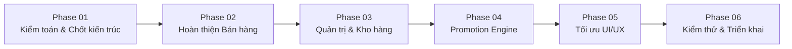

# 03_TECHNICAL_ROADMAP.md – LỘ TRÌNH KỸ THUẬT VÀ KẾ HOẠCH TRIỂN KHAI

> **Dự án:** FLOW – BLOOMORA  
> **Nguyên tắc cốt lõi:** Nâng cấp từng phần, không đập đi xây lại, tận dụng tối đa source code và database đang chạy tốt.  
> **Mục tiêu:** Đưa toàn bộ 14 hạng mục công việc (FLOW-01 đến FLOW-14) từ phân tích đến hoàn thiện và sẵn sàng triển khai thực tế.

---

## 1. LỘ TRÌNH 6 GIAI ĐOẠN (6-PHASE ROADMAP)

---

### Phase 01: Audit Hệ Thống & Chốt Thiết Kế Kỹ Thuật (Ưu tiên: Rất Cao - P0)
- **Mục tiêu:** Khảo sát toàn bộ mã nguồn thực tế tại `C:\xampp\htdocs\flow\`, lập hồ sơ kiểm toán, phát hiện lỗi ẩn và chốt thiết kế cơ sở dữ liệu mở rộng.
- **Công việc cụ thể:**
  1. Kiểm toán source code: Đã thực hiện rà soát 100% các file `admin/`, `api/`, `config/`, `js/`, `database/`.
  2. Xác định các điểm nghẽn kỹ thuật: Thiếu `cost_price` trong `products`, thiếu logic hoàn kho khi hủy đơn, hardcode giá phụ kiện, thiếu hoàn toàn phân hệ Promotion.
  3. Xây dựng 4 tài liệu kỹ thuật chuẩn (`01_CURRENT_STATE.md`, `02_FEATURE_GAP.md`, `03_TECHNICAL_ROADMAP.md`, `04_DATABASE_API_PLAN.md`).
- **Sản phẩm bàn giao:** Bộ 4 tài liệu kỹ thuật hoàn chỉnh tại thư mục `docs/`.

---

### Phase 02: Hoàn Thiện Nghiệp Vụ Bán Hàng Cốt Lõi (Ưu tiên: Rất Cao - P0)
- **Mục tiêu:** Vá triệt để các lỗi logic trong luồng mua hàng và tích hợp ô nhập mã Voucher tại Storefront.
- **Công việc cụ thể:**
  1. **Sửa lỗi Hủy đơn không hoàn kho:** Cập nhật `api/admin/orders.php`, bổ sung khối Transaction hoàn lại `stock_quantity` cho từng sản phẩm trong bảng `order_items` khi đơn hàng chuyển sang trạng thái `cancelled`.
  2. **Tích hợp giao diện Voucher vào Giỏ hàng & Checkout:**
     - Sửa `index.html`: Thêm ô input nhập mã Voucher, nút "Áp dụng", khối hiển thị chiết khấu giảm giá và thông báo lỗi.
     - Sửa `js/app.js`: Thêm hàm `applyVoucherCode()`, lưu trạng thái voucher vào `AppState`, cập nhật tổng tiền thanh toán hiển thị theo thời gian thực.
  3. **Tích hợp kiểm tra Voucher tại Checkout Backend:**
     - Sửa `api/checkout.php`: Tiếp nhận tham số `voucherCode`, gọi dịch vụ kiểm tra điều kiện mã, tính lại chiết khấu ở Server, ghi nhận vào `discount_amount` của bảng `orders`.
- **Files liên quan:**
  - Chỉnh sửa: `api/admin/orders.php`, `api/checkout.php`, `index.html`, `js/app.js`.
  - Tạo mới: `api/vouchers/apply.php`, `api/vouchers/check.php`.

---

### Phase 03: Quản Trị Hệ Thống & Quản Lý Tồn Kho (Ưu tiên: Cao - P1)
- **Mục tiêu:** Hoàn thiện bảng điều khiển Admin toàn diện, xóa bỏ tình trạng Admin chỉ quản lý được đơn hàng.
- **Công việc cụ thể:**
  1. **Quản lý Sản phẩm (Products CRUD):**
     - Tạo `api/admin/products.php`: Hỗ trợ GET (phân trang, tìm kiếm), POST (thêm mới mẫu hoa), PUT (chỉnh sửa giá, giá vốn `cost_price`, mô tả, tồn kho), DELETE (ẩn sản phẩm).
  2. **Quản lý Danh mục (Categories CRUD):**
     - Tạo `api/admin/categories.php`: Thêm, sửa, sắp xếp thứ tự hiển thị danh mục hoa.
  3. **Quản lý Tồn kho & Lịch sử Nhập xuất:**
     - Tạo bảng `inventory_logs` trong database.
     - Tạo `api/admin/inventory.php`: Cập nhật số lượng nhập kho, ghi nhận lý do (nhập hàng mới, kiểm kê, xả hàng, hoàn trả đơn hủy).
  4. **Quản lý Khách hàng:**
     - Tạo `api/admin/customers.php`: Xem danh sách thành viên, tổng số đơn đã mua, tổng tiền tích lũy, trạng thái tài khoản.
  5. **Nâng cấp Giao diện Admin (`admin/index.php`):**
     - Bổ sung thanh điều hướng Sidebar/Navbar chuyển đổi giữa các module: Đơn Hàng | Sản Phẩm | Kho Hàng | Khách Hàng | Khuyến Mãi.
- **Files liên quan:**
  - Chỉnh sửa: `admin/index.php`.
  - Tạo mới: `api/admin/products.php`, `api/admin/categories.php`, `api/admin/inventory.php`, `api/admin/customers.php`, `app/Services/InventoryService.php`.

---

### Phase 04: Bộ Máy Khuyến Mãi Thông Minh - Promotion Engine (Ưu tiên: Rất Cao - P0/P1)
- **Mục tiêu:** Xây dựng hệ thống khuyến mãi tự động đa tầng, bảo vệ biên lợi nhuận, chống thất thoát ngân sách.
- **Công việc cụ thể:**
  1. **Triển khai Database Migration:** Chạy file migration bổ sung 8 bảng quản lý khuyến mãi, voucher và ngân sách.
  2. **Xây dựng lớp Services xử lý nghiệp vụ:**
     - `app/Services/MarginService.php`: Tính toán biên lợi nhuận: $\text{Margin} = \frac{\text{Doanh thu thuần} - \text{Giá vốn}}{\text{Doanh thu thuần}} \ge \text{min\_margin}$.
     - `app/Services/ScheduleService.php`: Kiểm tra lịch theo: Ngày trong tháng (01-05, 10-15, 25-30), Dịp lễ (Valentine, 8/3, 20/10, Tết), Khung giờ Flash Sale.
     - `app/Services/BudgetService.php`: Khóa ngân sách, ghi log tiêu hao, tự động ngắt chiến dịch khi cạn ngân sách.
     - `app/Services/PromotionService.php`: Điều phối toàn bộ luồng khuyến mãi, kiểm tra xung đột mã, áp dụng giảm giá.
  3. **Xây dựng API Quản trị Khuyến mãi:**
     - `api/admin/promotions.php`: Tạo chiến dịch, phê duyệt chiến dịch (workflow duyệt bởi Admin).
     - `api/admin/vouchers.php`: Tạo mã giảm giá, giới hạn lượt dùng, theo dõi số lượt đã sử dụng.
  4. **Cơ chế Xả kho thông minh:**
     - Đề xuất mức giảm giá tối đa cho sản phẩm tồn kho lâu ngày nhưng đảm bảo không vi phạm biên lợi nhuận tối thiểu đã duyệt.
  5. **Cron Jobs tự động:**
     - Tạo `cron/activate_promotions.php` và `cron/expire_promotions.php` để tự động hóa việc bật/tắt chiến dịch.
- **Files liên quan:**
  - Tạo mới: Toàn bộ thư mục `app/Services/`, `api/admin/promotions.php`, `api/admin/vouchers.php`, `cron/activate_promotions.php`, `cron/expire_promotions.php`.

---

### Phase 05: Nâng Cấp Giao Diện UI/UX & Responsive (Ưu tiên: Cao - P2)
- **Mục tiêu:** Chuẩn hóa giao diện theo phong cách hiện đại, tinh tế của thương hiệu hoa tươi cao cấp, tối ưu trên thiết bị di động.
- **Công việc cụ thể:**
  1. **Component Flash Sale & Khuyến Mãi:** Thêm Banner động và đồng hồ đếm ngược (Countdown Timer) trực quan trên trang chủ `index.html`.
  2. **Tối ưu trải nghiệm Mobile:** Kiểm tra kích thước touch target của các nút bấm trên điện thoại (tối thiểu 44x44px), tối ưu thanh cuộn ngang danh mục và giỏ hàng trượt.
  3. **Trạng thái tương tác:** Bổ sung trạng thái Loading Spinner cho các nút bấm hành động (Thêm vào giỏ, Đặt hàng, Áp dụng voucher).
  4. **Hệ thống Toast Notification:** Thay thế các thông báo popup cơ bản bằng Toast Alert sang trọng, thông báo thành công / lỗi rõ ràng.
- **Files liên quan:**
  - Chỉnh sửa: `index.html`, `css/style.css`, `js/app.js`.

---

### Phase 06: Kiểm Thử Toàn Diện, Bảo Mật & Đóng Gói Triển Khai (Ưu tiên: Rất Cao - P0)
- **Mục tiêu:** Kiểm thử chức năng, kiểm thử tải nhiều người dùng đồng thời, kiểm tra bảo mật và đóng gói tài liệu bàn giao.
- **Công việc cụ thể:**
  1. **Kiểm thử Bảo mật:**
     - Rà soát lỗ hổng SQLi, XSS, CSRF.
     - Kiểm thử gian lận giá F12, kiểm thử race condition tranh chấp mã voucher cuối cùng.
  2. **Kiểm thử Nghiệp vụ Khuyến mãi & Kho:**
     - Kiểm thử biên lợi nhuận: Thử cố tình giảm giá vượt ngưỡng -> Hệ thống phải chặn thành công.
     - Kiểm thử hủy đơn: Đơn bị hủy -> Tồn kho và lượt voucher phải được hoàn trả chính xác 100%.
  3. **Benchmark Hiệu năng:**
     - Đo thời gian phản hồi API tìm kiếm/lọc (mục tiêu: dưới 300ms).
     - Kiểm tra First Contentful Paint (mục tiêu: dưới 1.5 giây).
  4. **Đóng gói triển khai:**
     - Xuất bản file SQL hoàn chỉnh `database/bloomora_full_export.sql`.
     - Viết tài liệu hướng dẫn cài đặt trên XAMPP và hướng dẫn đưa lên Production Web Hosting.

---

## 2. BẢNG QUẢN LÝ CÔNG VIỆC VÀ TIÊU CHÍ NGHIỆM THU (FLOW-01 ĐẾN FLOW-14)

| Mã CV | Hạng mục công việc | Phase | Ưu tiên | Trạng thái | Điều kiện & Tiêu chí nghiệm thu (Acceptance Criteria) |
|:---:|:---|:---:|:---:|:---:|:---|
| **FLOW-01** | Kiểm tra toàn bộ mã nguồn | Phase 01 | **P0** | **Hoàn thành** | Đã kiểm toán chi tiết từng file, có file `01_CURRENT_STATE.md`. |
| **FLOW-02** | Kiểm tra & Thiết kế Database | Phase 01 | **P0** | **Hoàn thành** | Có file `04_DATABASE_API_PLAN.md` và mã DDL Migration SQL đầy đủ. |
| **FLOW-03** | Hoàn thiện CRUD Sản phẩm | Phase 03 | **P0** | Chưa làm | Admin có thể thêm mới, chỉnh sửa giá, giá vốn, tồn kho, ẩn/hiện mẫu hoa qua giao diện. |
| **FLOW-04** | Giỏ hàng hoàn thiện | Phase 02 | **P0** | **Đạt 95%** | Thêm, sửa số lượng, xóa món, lưu trạng thái session/localStorage không lỗi. |
| **FLOW-05** | Checkout & Khóa giá an toàn | Phase 02 | **P0** | Đang làm | Backend tính toán 100% giá tiền, trừ tồn kho an toàn trong transaction, sinh VietQR chuẩn. |
| **FLOW-06** | Quản lý Đơn hàng & Hoàn kho | Phase 02 | **P0** | Đang làm | Cập nhật 5 bước trạng thái đơn, đính kèm ảnh hoa thật; **hoàn trả tồn kho và voucher khi hủy đơn**. |
| **FLOW-07** | Quản lý Tồn kho & Lịch sử | Phase 03 | **P1** | Chưa làm | Theo dõi lịch sử biến động nhập xuất (`inventory_logs`), cảnh báo tồn kho thấp. |
| **FLOW-08** | Áp dụng Voucher phía Client | Phase 02 | **P1** | Chưa làm | Khách nhập mã hợp lệ -> trừ tiền ngay; nhập mã hết hạn/không đủ điều kiện -> báo lỗi rõ ràng. |
| **FLOW-09** | Promotion Engine Tự Động | Phase 04 | **P1** | Chưa làm | Tự kích hoạt đúng lịch theo ngày, tháng, năm, dịp lễ và khung giờ Flash Sale. |
| **FLOW-10** | Xả kho có kiểm soát Margin | Phase 04 | **P1** | Chưa làm | Đề xuất giảm giá cho hàng tồn lâu ngày nhưng **tuyệt đối không vi phạm biên lợi nhuận tối thiểu**. |
| **FLOW-11** | Dashboard Quản trị Nâng cao | Phase 03 | **P2** | Đạt 70% | Hiển thị doanh thu thuần, chi phí giá vốn, lợi nhuận gộp và ngân sách khuyến mãi. |
| **FLOW-12** | Nâng cấp UI/UX & Responsive | Phase 05 | **P2** | Đạt 85% | Giao diện tương thích 100% Mobile, Tablet, Desktop; có banner Flash Sale và Toast Alerts. |
| **FLOW-13** | Kiểm thử Bảo mật Toàn diện | Phase 06 | **P0** | Đạt 80% | Vượt qua bài kiểm thử SQLi, XSS, CSRF, chống hack giá F12, mã hóa mật khẩu bcrypt. |
| **FLOW-14** | Benchmark Hiệu năng Hệ thống | Phase 06 | **P1** | Chưa làm | API lọc/tìm kiếm đạt thời gian phản hồi trung bình dưới 300ms; FCP dưới 1.5s. |

---

## 3. NGUYÊN TẮC VÀ QUY TRÌNH KIỂM THỬ TRƯỚC KHI BÀN GIAO

Mỗi tính năng mới khi được viết ra phải tuân thủ nghiêm ngặt quy trình kiểm thử 3 lớp:
1. **Kiểm thử Đơn vị & Tích hợp API (Layer 1):** Kiểm tra phản hồi HTTP Status Code (200, 400, 401, 403, 404, 500) và định dạng JSON trả về qua các trường hợp dữ liệu biên (edge cases).
2. **Kiểm thử Dữ liệu Database & Giao dịch (Layer 2):** Kiểm tra dữ liệu trong bảng sau khi thao tác. Kiểm tra tính toàn vẹn của Transaction: nếu có lỗi phát sinh giữa chừng, toàn bộ các bảng liên quan phải được khôi phục nguyên trạng (`rollBack`).
3. **Kiểm thử Giao diện Người dùng (Layer 3):** Thao tác trực tiếp trên trình duyệt ở cả chế độ Desktop và Mobile mô phỏng, kiểm tra thông báo Toast hiển thị đúng ngữ cảnh và không có lỗi cú pháp JavaScript trong Console.

