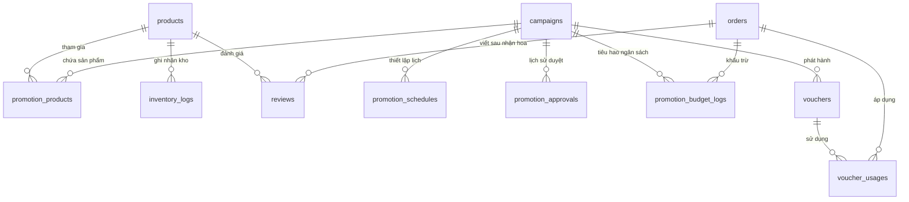

# 04_DATABASE_API_PLAN.md – KẾ HOẠCH NÂNG CẤP CƠ SỞ DỮ LIỆU & THIẾT KẾ REST API

> **Dự án:** FLOW – BLOOMORA  
> **Nguyên tắc:** Kế thừa 100% cấu trúc 7 bảng hiện có của `bloomora_db`. Không xóa hoặc đổi tên bảng đang hoạt động. Chỉ thực hiện migration bổ sung cột và tạo mới các bảng nghiệp vụ.

---

## 1. THIẾT KẾ CƠ SỞ DỮ LIỆU MỞ RỘNG (DATABASE SCHEMA DESIGN)

### 1.1. Sơ đồ quan hệ thực thể bổ sung (Entity-Relationship)



---

### 1.2. Kịch bản Migration SQL Thực Tế (Copy & Run Trực Tiếp)

```sql
-- ============================================================================
-- BLOOMORA MIGRATION SCRIPT: NÂNG CẤP PROMOTION ENGINE & QUẢN TRỊ TOÀN DIỆN
-- Tương thích: MySQL 5.7+ / MariaDB 10.4+ / XAMPP
-- Charset: utf8mb4_unicode_ci
-- ============================================================================

USE `bloomora_db`;

-- 1. BỔ SUNG CỘT GIÁ VỐN VÀO BẢNG PRODUCTS ĐỂ KIỂM SOÁT BIÊN LỢI NHUẬN
-- Kiểm tra nếu cột chưa tồn tại thì thêm mới
ALTER TABLE `products` 
ADD COLUMN `cost_price` DECIMAL(12, 2) NOT NULL DEFAULT 0.00 AFTER `sale_price`;

-- Cập nhật giá vốn mẫu cho 18 sản phẩm ban đầu (ước tính khoảng 50-60% giá niêm yết)
UPDATE `products` SET `cost_price` = `price` * 0.55 WHERE `cost_price` = 0;

-- Bổ sung cột ghi nhận mã voucher đã dùng vào bảng orders
ALTER TABLE `orders`
ADD COLUMN `voucher_code` VARCHAR(50) NULL AFTER `ribbon_message`;

-- 2. BẢNG CHIẾN DỊCH KHUYẾN MÃI (CAMPAIGNS)
CREATE TABLE IF NOT EXISTS `campaigns` (
    `id` INT AUTO_INCREMENT PRIMARY KEY,
    `name` VARCHAR(150) NOT NULL,
    `slug` VARCHAR(170) NOT NULL UNIQUE,
    `description` TEXT NULL,
    `campaign_type` ENUM('daily', 'monthly', 'yearly', 'holiday', 'flash_sale', 'clearance', 'loyalty') NOT NULL,
    `discount_type` ENUM('percentage', 'fixed_amount') NOT NULL DEFAULT 'percentage',
    `discount_value` DECIMAL(12, 2) NOT NULL,
    `min_order_value` DECIMAL(12, 2) DEFAULT 0.00,
    `max_discount_amount` DECIMAL(12, 2) NULL,
    `budget_limit` DECIMAL(12, 2) NOT NULL DEFAULT 0.00 COMMENT 'Ngân sách tối đa của chiến dịch (0 = không giới hạn)',
    `budget_used` DECIMAL(12, 2) NOT NULL DEFAULT 0.00 COMMENT 'Số tiền đã chiết khấu thực tế',
    `min_margin` DECIMAL(5, 2) NOT NULL DEFAULT 20.00 COMMENT 'Biên lợi nhuận tối thiểu bắt buộc (%)',
    `start_at` DATETIME NOT NULL,
    `end_at` DATETIME NOT NULL,
    `allow_stacking` TINYINT(1) DEFAULT 0 COMMENT '0: Không cho cộng dồn khuyến mãi khác, 1: Cho phép',
    `status` ENUM('draft', 'scheduled', 'active', 'paused', 'expired', 'budget_exhausted') DEFAULT 'draft',
    `approval_status` ENUM('pending', 'approved', 'rejected') DEFAULT 'pending',
    `created_by` INT NOT NULL,
    `created_at` TIMESTAMP DEFAULT CURRENT_TIMESTAMP,
    `updated_at` TIMESTAMP DEFAULT CURRENT_TIMESTAMP ON UPDATE CURRENT_TIMESTAMP,
    FOREIGN KEY (`created_by`) REFERENCES `users`(`id`)
) ENGINE=InnoDB DEFAULT CHARSET=utf8mb4 COLLATE=utf8mb4_unicode_ci;

-- 3. BẢNG MÃ GIẢM GIÁ (VOUCHERS)
CREATE TABLE IF NOT EXISTS `vouchers` (
    `id` INT AUTO_INCREMENT PRIMARY KEY,
    `campaign_id` INT NULL COMMENT 'Gắn với chiến dịch tổng hoặc tạo độc lập',
    `code` VARCHAR(50) NOT NULL UNIQUE,
    `description` VARCHAR(255) NULL,
    `discount_type` ENUM('percentage', 'fixed_amount') NOT NULL DEFAULT 'percentage',
    `discount_value` DECIMAL(12, 2) NOT NULL,
    `min_order_value` DECIMAL(12, 2) DEFAULT 0.00,
    `max_discount_amount` DECIMAL(12, 2) NULL,
    `usage_limit` INT NOT NULL DEFAULT 100 COMMENT 'Tổng số lượt dùng tối đa',
    `used_count` INT NOT NULL DEFAULT 0 COMMENT 'Số lượt đã sử dụng thực tế',
    `per_user_limit` INT NOT NULL DEFAULT 1 COMMENT 'Số lượt tối đa cho mỗi khách hàng',
    `start_at` DATETIME NOT NULL,
    `end_at` DATETIME NOT NULL,
    `is_active` TINYINT(1) DEFAULT 1,
    `created_at` TIMESTAMP DEFAULT CURRENT_TIMESTAMP,
    FOREIGN KEY (`campaign_id`) REFERENCES `campaigns`(`id`) ON DELETE SET NULL
) ENGINE=InnoDB DEFAULT CHARSET=utf8mb4 COLLATE=utf8mb4_unicode_ci;

-- 4. BẢNG THIẾT LẬP LỊCH TỰ ĐỘNG (PROMOTION_SCHEDULES)
CREATE TABLE IF NOT EXISTS `promotion_schedules` (
    `id` INT AUTO_INCREMENT PRIMARY KEY,
    `campaign_id` INT NOT NULL,
    `schedule_type` ENUM('specific_date', 'date_range', 'recurring_weekly', 'recurring_monthly', 'holiday') NOT NULL,
    `day_of_week` TINYINT NULL COMMENT '1: Chủ nhật, 2: Thứ 2 ... 7: Thứ 7',
    `day_of_month` VARCHAR(50) NULL COMMENT 'Ví dụ: "01-05" hoặc "25-30"',
    `month` TINYINT NULL COMMENT 'Tháng áp dụng (1 - 12)',
    `holiday_name` VARCHAR(100) NULL COMMENT 'Valentine, 8/3, 20/10, Tết...',
    `start_time` TIME NOT NULL DEFAULT '00:00:00',
    `end_time` TIME NOT NULL DEFAULT '23:59:59',
    `is_active` TINYINT(1) DEFAULT 1,
    FOREIGN KEY (`campaign_id`) REFERENCES `campaigns`(`id`) ON DELETE CASCADE
) ENGINE=InnoDB DEFAULT CHARSET=utf8mb4 COLLATE=utf8mb4_unicode_ci;

-- 5. BẢNG SẢN PHẨM THAM GIA KHUYẾN MÃI / XẢ KHO (PROMOTION_PRODUCTS)
CREATE TABLE IF NOT EXISTS `promotion_products` (
    `id` INT AUTO_INCREMENT PRIMARY KEY,
    `campaign_id` INT NOT NULL,
    `product_id` INT NOT NULL,
    `custom_discount_value` DECIMAL(12, 2) NULL COMMENT 'Mức giảm riêng cho sản phẩm này nếu khác chiến dịch',
    `max_quantity` INT DEFAULT 0 COMMENT 'Số lượng tối đa cho phép mua giá khuyến mãi (0 = toàn bộ kho)',
    `sold_quantity` INT DEFAULT 0,
    FOREIGN KEY (`campaign_id`) REFERENCES `campaigns`(`id`) ON DELETE CASCADE,
    FOREIGN KEY (`product_id`) REFERENCES `products`(`id`) ON DELETE RESTRICT
) ENGINE=InnoDB DEFAULT CHARSET=utf8mb4 COLLATE=utf8mb4_unicode_ci;

-- 6. BẢNG LỊCH SỬ SỬ DỤNG VOUCHER (VOUCHER_USAGES)
CREATE TABLE IF NOT EXISTS `voucher_usages` (
    `id` INT AUTO_INCREMENT PRIMARY KEY,
    `voucher_id` INT NOT NULL,
    `order_id` INT NOT NULL,
    `user_id` INT NULL COMMENT 'Null nếu khách vãng lai mua nhanh',
    `discount_amount` DECIMAL(12, 2) NOT NULL,
    `status` ENUM('used', 'refunded') DEFAULT 'used',
    `used_at` TIMESTAMP DEFAULT CURRENT_TIMESTAMP,
    FOREIGN KEY (`voucher_id`) REFERENCES `vouchers`(`id`) ON DELETE RESTRICT,
    FOREIGN KEY (`order_id`) REFERENCES `orders`(`id`) ON DELETE CASCADE
) ENGINE=InnoDB DEFAULT CHARSET=utf8mb4 COLLATE=utf8mb4_unicode_ci;

-- 7. BẢNG LỊCH SỬ PHÊ DUYỆT CHIẾN DỊCH (PROMOTION_APPROVALS)
CREATE TABLE IF NOT EXISTS `promotion_approvals` (
    `id` INT AUTO_INCREMENT PRIMARY KEY,
    `campaign_id` INT NOT NULL,
    `admin_id` INT NOT NULL,
    `action` ENUM('submitted', 'approved', 'rejected', 'paused') NOT NULL,
    `note` TEXT NULL,
    `created_at` TIMESTAMP DEFAULT CURRENT_TIMESTAMP,
    FOREIGN KEY (`campaign_id`) REFERENCES `campaigns`(`id`) ON DELETE CASCADE,
    FOREIGN KEY (`admin_id`) REFERENCES `users`(`id`)
) ENGINE=InnoDB DEFAULT CHARSET=utf8mb4 COLLATE=utf8mb4_unicode_ci;

-- 8. BẢNG THEO DÕI BIẾN ĐỘNG NGÂN SÁCH (PROMOTION_BUDGET_LOGS)
CREATE TABLE IF NOT EXISTS `promotion_budget_logs` (
    `id` INT AUTO_INCREMENT PRIMARY KEY,
    `campaign_id` INT NOT NULL,
    `order_id` INT NOT NULL,
    `amount_deducted` DECIMAL(12, 2) NOT NULL,
    `budget_remaining` DECIMAL(12, 2) NOT NULL,
    `type` ENUM('spend', 'refund') NOT NULL,
    `created_at` TIMESTAMP DEFAULT CURRENT_TIMESTAMP,
    FOREIGN KEY (`campaign_id`) REFERENCES `campaigns`(`id`) ON DELETE RESTRICT,
    FOREIGN KEY (`order_id`) REFERENCES `orders`(`id`) ON DELETE CASCADE
) ENGINE=InnoDB DEFAULT CHARSET=utf8mb4 COLLATE=utf8mb4_unicode_ci;

-- 9. BẢNG NHẬT KÝ BIẾN ĐỘNG KHO (INVENTORY_LOGS)
CREATE TABLE IF NOT EXISTS `inventory_logs` (
    `id` INT AUTO_INCREMENT PRIMARY KEY,
    `product_id` INT NOT NULL,
    `change_quantity` INT NOT NULL COMMENT 'Dương (+) là nhập kho/hoàn kho; Âm (-) là bán/xuất hủy',
    `remaining_quantity` INT NOT NULL,
    `reason` ENUM('import', 'sale', 'cancel_refund', 'damage', 'clearance', 'audit_adjustment') NOT NULL,
    `order_id` INT NULL,
    `user_id` INT NULL COMMENT 'Người thực hiện thao tác (Admin hoặc Florist)',
    `note` VARCHAR(255) NULL,
    `created_at` TIMESTAMP DEFAULT CURRENT_TIMESTAMP,
    FOREIGN KEY (`product_id`) REFERENCES `products`(`id`) ON DELETE RESTRICT,
    FOREIGN KEY (`order_id`) REFERENCES `orders`(`id`) ON DELETE SET NULL
) ENGINE=InnoDB DEFAULT CHARSET=utf8mb4 COLLATE=utf8mb4_unicode_ci;

-- 10. BẢNG ĐÁNH GIÁ SẢN PHẨM CỦA KHÁCH HÀNG (REVIEWS)
CREATE TABLE IF NOT EXISTS `reviews` (
    `id` INT AUTO_INCREMENT PRIMARY KEY,
    `product_id` INT NOT NULL,
    `order_id` INT NOT NULL,
    `user_id` INT NULL,
    `customer_name` VARCHAR(100) NOT NULL,
    `rating` TINYINT NOT NULL DEFAULT 5,
    `comment` TEXT NOT NULL,
    `is_approved` TINYINT(1) DEFAULT 1,
    `created_at` TIMESTAMP DEFAULT CURRENT_TIMESTAMP,
    FOREIGN KEY (`product_id`) REFERENCES `products`(`id`) ON DELETE RESTRICT,
    FOREIGN KEY (`order_id`) REFERENCES `orders`(`id`) ON DELETE CASCADE
) ENGINE=InnoDB DEFAULT CHARSET=utf8mb4 COLLATE=utf8mb4_unicode_ci;

-- ============================================================================
-- DỮ LIỆU MẪU BAN ĐẦU CHO CHƯƠNG TRÌNH KHUYẾN MÃI & VOUCHER
-- ============================================================================

-- Tạo chiến dịch Khai trương Bloomora 2026
INSERT INTO `campaigns` (`id`, `name`, `slug`, `description`, `campaign_type`, `discount_type`, `discount_value`, `min_order_value`, `max_discount_amount`, `budget_limit`, `budget_used`, `min_margin`, `start_at`, `end_at`, `status`, `approval_status`, `created_by`) VALUES
(1, 'Mừng Khai Trương Hệ Thống Bloomora', 'mung-khai-truong-bloomora', 'Giảm 10% cho mọi đơn hoa tươi mừng ra mắt thương hiệu', 'holiday', 'percentage', 10.00, 500000, 150000, 50000000, 0, 25.00, '2026-11-01 00:00:00', '2026-12-31 23:59:59', 'active', 'approved', 1);

-- Tạo voucher mẫu BLOOMORA10 & CHAO2026
INSERT INTO `vouchers` (`id`, `campaign_id`, `code`, `description`, `discount_type`, `discount_value`, `min_order_value`, `max_discount_amount`, `usage_limit`, `used_count`, `per_user_limit`, `start_at`, `end_at`, `is_active`) VALUES
(1, 1, 'BLOOMORA10', 'Giảm 10% tối đa 100k cho đơn từ 500k', 'percentage', 10.00, 500000, 100000, 200, 0, 1, '2026-11-01 00:00:00', '2026-12-31 23:59:59', 1),
(2, NULL, 'GIAM50K', 'Giảm ngay 50.000đ cho đơn hoa từ 600k', 'fixed_amount', 50000, 600000, 50000, 100, 0, 1, '2026-11-01 00:00:00', '2026-12-31 23:59:59', 1);
```

---

## 2. HỢP ĐỒNG THIẾT KẾ RESTFUL API (API CONTRACTS)

### 2.1. API Áp Dụng & Kiểm Tra Voucher (Dành cho Khách Hàng)

#### Endpoint 1: Kiểm Tra Voucher Khi Nhập Mã
- **Method:** `POST`
- **URL:** `/api/vouchers/apply.php`
- **Headers:** `Content-Type: application/json`
- **Request Body:**
```json
{
  "code": "BLOOMORA10",
  "subtotal": 1350000,
  "items": [
    { "productId": 1, "quantity": 1, "price": 1350000 }
  ]
}
```
- **Response Success (200 OK):**
```json
{
  "success": true,
  "message": "Áp dụng mã giảm giá thành công!",
  "data": {
    "voucherCode": "BLOOMORA10",
    "discountType": "percentage",
    "discountValue": 10,
    "discountAmount": 100000,
    "finalSubtotal": 1250000
  }
}
```
- **Response Error (400 Bad Request):**
```json
{
  "success": false,
  "message": "Mã giảm giá chỉ áp dụng cho đơn hàng tối thiểu từ 500.000 ₫!"
}
```

---

### 2.2. Nâng Cấp API Tạo Đơn Hàng (`POST /api/checkout.php`)

- **Payload bổ sung tham số:** `voucherCode`
- **Quy trình xử lý cốt lõi trong Transaction:**
  1. `BEGIN TRANSACTION;`
  2. Truy vấn giá bán và giá vốn sản phẩm từ DB với `FOR UPDATE`.
  3. Kiểm tra và trừ tồn kho: `UPDATE products SET stock_quantity = stock_quantity - :qty ...`
  4. Nếu có `voucherCode`:
     - Khóa bản ghi voucher: `SELECT * FROM vouchers WHERE code = :code AND is_active = 1 FOR UPDATE;`
     - Kiểm tra hạn dùng, kiểm tra `used_count < usage_limit`.
     - Kiểm tra biên lợi nhuận qua `MarginService`:
       $$\text{Doanh thu thuần} = \text{Tổng tiền bán} - \text{Số tiền giảm}$$
       $$\text{Lợi nhuận gộp} = \text{Doanh thu thuần} - \text{Tổng giá vốn}$$
       $$\text{Biên lợi nhuận} = \frac{\text{Lợi nhuận gộp}}{\text{Doanh thu thuần}} \times 100\%$$
       *Nếu biên lợi nhuận < min_margin đã duyệt của chiến dịch -> Từ chối áp dụng voucher hoặc giảm mức chiết khấu xuống ngưỡng trần an toàn.*
     - Tăng số lượt dùng: `UPDATE vouchers SET used_count = used_count + 1 WHERE id = :id;`
     - Ghi nhật ký vào `voucher_usages` và `promotion_budget_logs`.
  5. Thêm bản ghi `orders` (lưu `discount_amount`, `voucher_code`, `total_amount = subtotal - discount_amount`).
  6. Thêm bản ghi `order_items`.
  7. Thêm bản ghi `inventory_logs` (lý do: `sale`).
  8. `COMMIT;`

---

### 2.3. Nhóm API Quản Trị Sản Phẩm (`/api/admin/products.php`)

#### GET: Lấy Danh Sách Sản Phẩm Cho Admin
- **URL:** `/api/admin/products.php?page=1&limit=20&search=hướng+dương`
- **Quyền:** `admin`, `staff`
- **Response:**
```json
{
  "success": true,
  "data": {
    "total": 18,
    "page": 1,
    "limit": 20,
    "items": [
      {
        "id": 1,
        "sku": "KT01",
        "name": "Kệ Khai Trương Đại Cát Đại Lợi",
        "categoryName": "Hoa Khai Trương",
        "price": 1350000,
        "cost_price": 742500,
        "profit_margin": "45.0%",
        "stock_quantity": 25,
        "is_active": 1,
        "thumbnail": "https://..."
      }
    ]
  }
}
```

#### POST: Thêm Mới Mẫu Hoa
- **URL:** `/api/admin/products.php`
- **Request Body:**
```json
{
  "name": "Bó Hoa Cúc Họa Mi Trắng Tinh Khôi",
  "category_id": 2,
  "sku": "SN05",
  "price": 450000,
  "cost_price": 220000,
  "stock_quantity": 30,
  "primary_flower": "Cúc họa mi Nhật Tân",
  "color": "trang",
  "color_name": "Trắng Tinh Khiết",
  "meaning": "Tình bạn trong sáng, lời chúc bình an",
  "thumbnail": "https://..."
}
```

#### PUT: Cập Nhật Thông Tin Hoa & Giá Vốn
- **URL:** `/api/admin/products.php?id=1`
- **Request Body:** Cập nhật bất kỳ trường nào (`price`, `cost_price`, `stock_quantity`, `is_active`).

---

### 2.4. Nhóm API Quản Trị Khuyến Mãi (`/api/admin/promotions.php`)

- **GET `/api/admin/promotions.php`:** Lấy danh sách tất cả các chiến dịch kèm trạng thái phê duyệt và ngân sách đã tiêu.
- **POST `/api/admin/promotions.php`:** Tạo chiến dịch mới (yêu cầu điền đầy đủ `start_at`, `end_at`, `min_margin`, `budget_limit`).
- **POST `/api/admin/promotions/approve.php`:** Quản trị viên phê duyệt hoặc từ chối chiến dịch.

---

### 2.5. Nâng Cấp Logic Hủy Đơn Hàng (`POST /api/admin/orders.php`)

Khi Admin đổi trạng thái đơn sang `cancelled`:
```php
if ($newStatus === 'cancelled' && $existingOrder['order_status'] !== 'cancelled') {
    // 1. Lấy danh sách sản phẩm trong đơn
    $itemsStmt = $pdo->prepare("SELECT product_id, quantity FROM order_items WHERE order_id = :oid");
    $itemsStmt->execute([':oid' => $orderId]);
    $items = $itemsStmt->fetchAll();

    // 2. Hoàn lại tồn kho cho từng sản phẩm và ghi log
    $refundStockStmt = $pdo->prepare("UPDATE products SET stock_quantity = stock_quantity + :qty WHERE id = :id");
    $logStockStmt = $pdo->prepare("INSERT INTO inventory_logs (product_id, change_quantity, remaining_quantity, reason, order_id, user_id, note)
                                   SELECT :pid, :qty, stock_quantity, 'cancel_refund', :oid, :uid, 'Hoàn kho do hủy đơn hàng'
                                   FROM products WHERE id = :pid2");

    foreach ($items as $it) {
        $refundStockStmt->execute([':qty' => $it['quantity'], ':id' => $it['product_id']]);
        $logStockStmt->execute([
            ':pid' => $it['product_id'],
            ':qty' => $it['quantity'],
            ':oid' => $orderId,
            ':uid' => $currentAdminId,
            ':pid2' => $it['product_id']
        ]);
    }

    // 3. Nếu đơn có áp dụng voucher, hoàn lại lượt dùng và ngân sách
    if (!empty($existingOrder['voucher_code'])) {
        $pdo->prepare("UPDATE vouchers SET used_count = GREATEST(0, used_count - 1) WHERE code = :code")
            ->execute([':code' => $existingOrder['voucher_code']]);

        $pdo->prepare("UPDATE voucher_usages SET status = 'refunded' WHERE order_id = :oid")
            ->execute([':oid' => $orderId]);
    }
}
```

---

## 3. THUẬT TOÁN BẢO VỆ BIÊN LỢI NHUẬN (MARGIN GUARD ALGORITHM)

Thuật toán được thực thi tại `app/Services/MarginService.php`:

```php
<?php
namespace App\Services;

class MarginService {
    /**
     * Kiểm tra tính an toàn về lợi nhuận của đơn hàng khi áp dụng khuyến mãi
     * @param float $subtotal Tổng tiền hàng trước giảm
     * @param float $discountAmount Số tiền dự kiến giảm
     * @param float $totalCostPrice Tổng giá vốn của các sản phẩm trong giỏ
     * @param float $minMarginPercent Ngưỡng biên lợi nhuận tối thiểu (%)
     * @return array [bool $isSafe, float $actualMargin, float $maxAllowedDiscount]
     */
    public static function evaluateSafety($subtotal, $discountAmount, $totalCostPrice, $minMarginPercent = 20.0) {
        $netRevenue = $subtotal - $discountAmount;
        
        // Không bao giờ cho phép doanh thu thuần nhỏ hơn hoặc bằng 0
        if ($netRevenue <= 0) {
            return [
                'isSafe' => false,
                'actualMargin' => 0.0,
                'maxAllowedDiscount' => max(0, $subtotal - ($totalCostPrice / (1 - ($minMarginPercent / 100)))),
                'message' => 'Mức giảm giá vượt quá giá trị đơn hàng!'
            ];
        }

        // Lợi nhuận gộp = Doanh thu thuần - Giá vốn
        $grossProfit = $netRevenue - $totalCostPrice;
        
        // Biên lợi nhuận (%) = (Lợi nhuận gộp / Doanh thu thuần) * 100
        $actualMargin = ($grossProfit / $netRevenue) * 100;

        // Tính số tiền giảm giá tối đa mà vẫn đạt minMarginPercent
        // netRevenue >= totalCostPrice / (1 - minMargin)
        // subtotal - maxDiscount = totalCostPrice / (1 - minMargin)
        $minAllowedNetRevenue = $totalCostPrice / (1 - ($minMarginPercent / 100));
        $maxAllowedDiscount = max(0, round($subtotal - $minAllowedNetRevenue));

        $isSafe = ($actualMargin >= $minMarginPercent);

        return [
            'isSafe' => $isSafe,
            'actualMargin' => round($actualMargin, 2),
            'maxAllowedDiscount' => $maxAllowedDiscount,
            'message' => $isSafe ? 'An toàn' : "Biên lợi nhuận ({$actualMargin}%) thấp hơn ngưỡng tối thiểu ({$minMarginPercent}%)!"
        ];
    }
}
```

