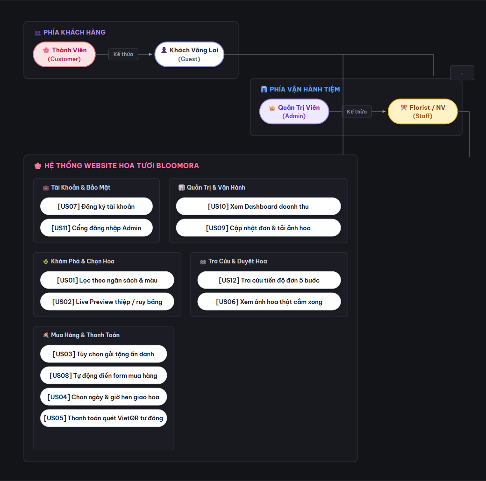
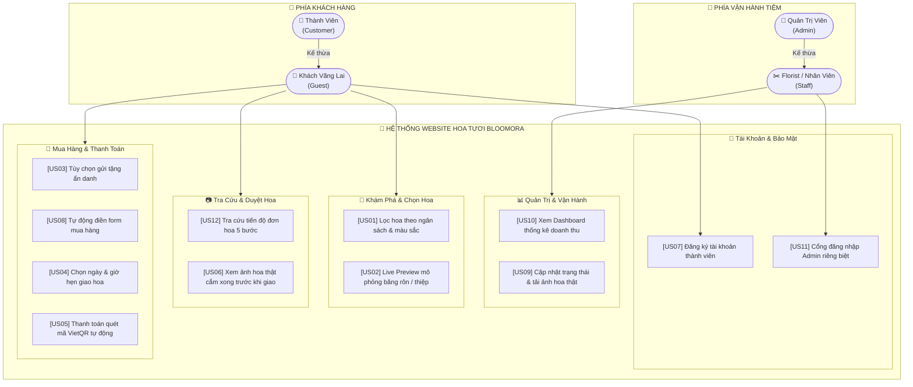
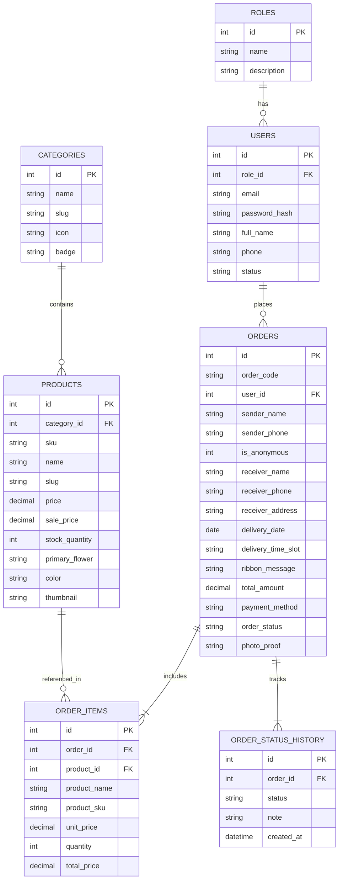

# BÁO CÁO ĐỒ ÁN CHUYÊN NGÀNH: PHÁT TRIỂN ỨNG DỤNG WEB
## ĐỀ TÀI: XÂY DỰNG WEBSITE THƯƠNG MẠI ĐIỆN TỬ HOA TƯƠI TRỰC TUYẾN BLOOMORA

---

# MỤC LỤC
- [LỜI MỞ ĐẦU](#lời-mở-đầu)
- [PHẦN 1 – GIỚI THIỆU ĐỀ TÀI](#phần-1--giới-thiệu-đề-tài)
  - [1.1. Lý do chọn đề tài](#11-lý-do-chọn-đề-tài)
  - [1.2. Mục tiêu và phạm vi đề tài](#12-mục-tiêu-và-phạm-vi-đề-tài)
  - [1.3. Đối tượng và phạm vi sử dụng](#13-đối-tượng-và-phạm-vi-sử-dụng)
  - [1.4. Phương pháp và công cụ thực hiện](#14-phương-pháp-và-công-cụ-thực-hiện)
- [PHẦN 2 – PHÂN TÍCH YÊU CẦU](#phần-2--phân-tích-yêu-cầu)
  - [2.1. Khảo sát hiện trạng](#21-khảo-sát-hiện-trạng)
  - [2.2. Yêu cầu Chức năng](#22-yêu-cầu-chức-năng)
  - [2.3. Danh sách Actor](#23-danh-sách-actor)
  - [2.4. Danh sách User Story](#24-danh-sách-user-story)
  - [2.5. Sơ đồ Use Case tổng quát](#25-sơ-đồ-use-case-tổng-quát)
  - [2.6. Đặc tả Use Case chi tiết](#26-đặc-tả-use-case-chi-tiết)
  - [2.7. Yêu cầu phi chức năng](#27-yêu-cầu-phi-chức-năng)
- [PHẦN 3 – THIẾT KẾ](#phần-3--thiết-kế)
  - [3.1. Thiết kế giao diện (UI/UX, Sitemap)](#31-thiết-kế-giao-diện-uiux-sitemap)
  - [3.2. Thiết kế cơ sở dữ liệu (Sơ đồ ERD & Data Dictionary)](#32-thiết-kế-cơ-sở-dữ-liệu-sơ-đồ-erd--data-dictionary)
  - [3.3. Thiết kế kiến trúc hệ thống (MVC & REST API)](#33-thiết-kế-kiến-trúc-hệ-thống-mvc--rest-api)
- [PHẦN 4 – THỰC HIỆN DỰ ÁN](#phần-4--thực-hiện-dự-án)
  - [4.1. Cấu trúc thư mục mã nguồn](#41-cấu-trúc-thư-mục-mã-nguồn)
  - [4.2. Các chức năng đã hoàn thành](#42-các-chức-năng-đã-hoàn-thành)
  - [4.3. Các đoạn mã nguồn tiêu biểu](#43-các-đoạn-mã-nguồn-tiêu-biểu)
- [PHẦN 5 – KIỂM LỖI (TESTING)](#phần-5--kiểm-lỗi-testing)
  - [5.1. Kế hoạch và phạm vi kiểm thử](#51-kế-hoạch-và-phạm-vi-kiểm-thử)
  - [5.2. Bảng Test Case chi tiết (20 Test Cases)](#52-bảng-test-case-chi-tiết-20-test-cases)
  - [5.3. Báo cáo lỗi và cách khắc phục](#53-báo-cáo-lỗi-và-cách-khắc-phục)
- [PHẦN 6 – TRIỂN KHAI](#phần-6--triển-khai)
  - [6.1. Đóng gói sản phẩm](#61-đóng-gói-sản-phẩm)
  - [6.2. Hướng dẫn cài đặt môi trường Local](#62-hướng-dẫn-cài-đặt-môi-trường-local)
  - [6.3. Triển khai lên Hosting / Máy chủ thật](#63-triển-khai-lên-hosting--máy-chủ-thật)
- [PHẦN 7 – KẾT LUẬN](#phần-7--kết-luận)
  - [7.1. Kết quả đạt được](#71-kết-quả-đạt-được)
  - [7.2. Hạn chế và hướng phát triển](#72-hạn-chế-và-hướng-phát-triển)
- [PHỤ LỤC](#phụ-lục)
- [TÀI LIỆU THAM KHẢO](#tài-liệu-tham-khảo)

---

# LỜI MỞ ĐẦU

Trong bối cảnh chuyển đổi số và sự bùng nổ của thương mại điện tử hiện nay, việc phát triển các nền tảng bán lẻ chuyên biệt hóa theo từng ngành hàng là một xu thế tất yếu. Ngành kinh doanh hoa tươi và dịch vụ điện hoa tại Việt Nam mang những nét đặc thù rất riêng: sản phẩm có vòng đời ngắn, giá cả biến động mạnh theo dịp lễ, đòi hỏi cao về mặt thẩm mỹ và đặc biệt là nhu cầu giao nhận hẹn giờ chính xác kèm thông điệp lời chúc riêng biệt. 

Xuất phát từ yêu cầu của môn học **Phát triển Ứng dụng Web**, đồ án **"Xây dựng Website Thương mại Điện tử Hoa tươi Trực tuyến Bloomora"** được nhóm thực hiện nhằm vận dụng các kiến trúc lập trình web hướng đối tượng (OOP), mô hình MVC, thư viện bảo mật PDO và công nghệ REST API vào việc giải quyết trọn vẹn bài toán kinh doanh hoa tươi thực tế. Hệ thống không chỉ cung cấp giao diện mua sắm thẩm mỹ cao, hỗ trợ đặt hoa theo ngân sách, màu sắc, xem trước băng rôn chúc mừng, mà còn tích hợp phương thức thanh toán VietQR tự động và quy trình duyệt ảnh hoa thực tế 5 bước khép kín.

Báo cáo đồ án được kết cấu thành **7 phần chính**:
1. **Phần 1 – Giới thiệu đề tài:** Trình bày lý do chọn đề tài, mục tiêu, đối tượng sử dụng và công cụ triển khai.
2. **Phần 2 – Phân tích yêu cầu:** Khảo sát các website quốc tế, lập danh sách Actor, User Story, sơ đồ Use Case và đặc tả chi tiết.
3. **Phần 3 – Thiết kế:** Thiết kế giao diện UI/UX, bảng màu, sơ đồ quan hệ thực thể (ERD) và kiến trúc hệ thống.
4. **Phần 4 – Thực hiện dự án:** Trình bày cấu trúc mã nguồn, các phân hệ đã hoàn thành và trích đoạn mã nguồn quan trọng.
5. **Phần 5 – Kiểm lỗi:** Kế hoạch kiểm thử, bảng 20 Test Cases chi tiết và phân tích vá lỗi bảo mật (SQLi, XSS, Hack giá).
6. **Phần 6 – Triển khai:** Hướng dẫn đóng gói, cài đặt môi trường Local (XAMPP) và đưa lên Hosting.
7. **Phần 7 – Kết luận:** Đánh giá mức độ hoàn thành, hạn chế và đề xuất hướng phát triển hệ thống trong tương lai.

---

# PHẦN 1 – GIỚI THIỆU ĐỀ TÀI

### 1.1. Lý do chọn đề tài
Đề tài Bloomora được lựa chọn dựa trên 4 tiêu chí cốt lõi:
1. **Tính thực tiễn cao:** Hoa tươi là món quà tinh thần không thể thiếu trong các dịp Khai trương, Sinh nhật, Tình yêu, Tri ân và Tang lễ tại Việt Nam. Khách hàng ngày nay mong muốn gửi hoa tặng người thân từ xa một cách nhanh chóng, minh bạch mà không cần đến trực tiếp cửa hàng.
2. **Giải quyết khoảng trống thị trường:** Nhiều website bán hoa hiện nay vẫn mang tính chất "chợ hoa tĩnh", thiếu công cụ lọc trực quan theo ngân sách/màu sắc, khách hàng không biết được hoa cắm thật ngoài đời có giống ảnh mạng hay không, và việc chuyển khoản thủ công tốn nhiều thời gian đối soát.
3. **Tính khả thi về mặt kỹ thuật:** Đề tài phù hợp hoàn toàn với khối lượng kiến thức của học phần: Xây dựng cơ sở dữ liệu quan hệ MySQL, lập trình Backend PHP chuẩn PDO, xử lý Ajax/REST API không reload trang và bảo mật phiên Session.
4. **Khả năng mở rộng:** Hệ thống có khả năng nâng cấp module thiết kế bó hoa tự chọn (Custom Bouquet) và tích hợp AI tư vấn hoa theo cảm xúc.

### 1.2. Mục tiêu và phạm vi đề tài
**Website hướng tới:** Người tiêu dùng có nhu cầu đặt hoa tặng người thân, đối tác doanh nghiệp đặt hoa khai trương/sự kiện, và chủ tiệm hoa cần số hóa quy trình quản lý đơn hàng.

**5 Mục tiêu cụ thể, đo lường được:**
*   **Mục tiêu 1:** Xây dựng website đạt thời gian tải trang trung bình dưới **1.5 giây**, giao diện tương thích 100% trên cả Desktop, Tablet và Mobile (Responsive).
*   **Mục tiêu 2:** Tối ưu luồng đặt hàng (Checkout) giúp khách hoàn tất đơn hoa và nhận mã VietQR chuyển khoản trong vòng chưa đầy **60 giây**.
*   **Mục tiêu 3:** Xây dựng quy trình xử lý đơn 5 bước minh bạch, có chức năng cập nhật và hiển thị ảnh hoa thực tế cắm xong (`photo_proof`) cho khách duyệt trước khi giao.
*   **Mục tiêu 4:** Bảo mật 100% các câu lệnh truy vấn dữ liệu chống tấn công SQL Injection thông qua Prepared Statements, chống can thiệp sửa giá Client.
*   **Mục tiêu 5:** Cung cấp trang Quản trị Admin trực quan, theo dõi doanh thu và trạng thái đơn hàng thời gian thực.

### 1.3. Đối tượng và phạm vi sử dụng
*   **Đối tượng sử dụng (Actors):**
    *   *Khách vãng lai (Guest):* Xem mẫu hoa, tìm kiếm, lọc theo giá/màu, đặt hoa nhanh không ép buộc đăng ký.
    *   *Khách hàng thành viên (Customer):* Có tài khoản cá nhân, xem lịch sử đơn hoa, tự động điền thông tin khi mua hàng.
    *   *Nghệ nhân Florist / Nhân viên (Staff):* Tiếp nhận đơn hoa, cập nhật trạng thái đang cắm, tải ảnh chụp sản phẩm thực tế lên hệ thống.
    *   *Quản trị viên (Admin):* Toàn quyền quản lý hoa, danh mục, đơn hàng, tài khoản và báo cáo doanh thu.
*   **Phạm vi chức năng:**
    *   *Nằm trong đề tài:* Đăng ký/đăng nhập phân quyền, bộ lọc đa chiều, giỏ hàng, Checkout hẹn giờ, Live Preview băng rôn, VietQR động, tra cứu tiến độ đơn, Dashboard Admin.
    *   *Nằm ngoài đề tài:* Cổng thanh toán quốc tế Visa/Mastercard tự động (sử dụng VietQR và MoMo mô phỏng), định vị GPS tài xế theo thời gian thực (hiển thị trạng thái phân chặng).

### 1.4. Phương pháp và công cụ thực hiện
*   **Mô hình kiến trúc:** Mô hình MVC (Model - View - Controller) kết hợp kiến trúc dịch vụ RESTful API.
*   **Ngôn ngữ & Công nghệ:** PHP 8.0+ (Backend), MariaDB/MySQL 10.4+ (Database), HTML5, CSS3, Tailwind CSS framework, JavaScript ES6+ (Frontend).
*   **Ứng dụng công cụ AI trong từng giai đoạn phát triển:**
    *   *Giai đoạn phân tích:* Sử dụng ChatGPT/Claude để phân tích nghiệp vụ điện hoa, xây dựng bộ tiêu chí User Story và bảng Test Case.
    *   *Giai đoạn thiết kế & Code:* Sử dụng Google Antigravity & AI Assistant hỗ trợ sinh khung mã nguồn chuẩn Clean Code, viết truy vấn SQL 3NF và tối ưu thuật toán băm mật khẩu `bcrypt`.
    *   *Giai đoạn kiểm lỗi:* Dùng AI đóng vai trò Tester thực hiện kiểm tra lỗ hổng bảo mật (SQL Injection, XSS, F12 Price Tampering).

---

# PHẦN 2 – PHÂN TÍCH YÊU CẦU

### <a id="21-khảo-sát-hiện-trạng"></a>2.1. Khảo sát hiện trạng
*(Khảo sát 2 website thương mại điện tử hoa tươi tham khảo: WishFlorist & FlowerDJ)*
Nhóm đã tiến hành khảo sát 2 website thương mại điện tử hoa tươi quốc tế tiêu biểu:
1.  **WishFlorist (wishflorist.com.tw - Đài Bắc):**
    *   *Điểm mạnh:* Danh mục phong phú, phân loại dịp tặng rất chi tiết, form thông tin người gửi/nhận tách biệt.
    *   *Điểm yếu:* Giao diện mang phong cách truyền thống cũ, chưa có xem trước trực quan dải băng rôn, thanh toán chưa thân thiện với người Việt.
2.  **FlowerDJ (flowerdj.com - Sàn hoa trực tuyến số 1 Đài Loan):**
    *   *Điểm mạnh:* Hộp tìm hoa 3 bước thông minh, cam kết chụp ảnh hoa thực tế trước khi đi giao, hệ thống tra cứu đơn hàng trực quan.
    *   *Điểm yếu:* Giao diện nhiều chữ, độ phức tạp cao gây rối mắt cho người dùng di động.
*   **Bài học rút ra cho Bloomora:** Kế thừa hộp tìm hoa nhanh và quy trình chụp ảnh duyệt hoa thực tế của FlowerDJ, nhưng tái thiết kế theo phong cách tối giản (Modern Minimalist), thuần hóa ngôn ngữ, tiền tệ VNĐ và tích hợp mã thanh toán VietQR ngân hàng Việt Nam.

### 2.2. Yêu cầu Chức năng
Hệ thống được chia thành 5 phân hệ lớn:
1.  **Phân hệ Duyệt & Tìm kiếm hoa:** Xem danh mục, tìm kiếm realtime, lọc kết hợp Dịp tặng + Khoảng giá + Tông màu hoa, sắp xếp giá.
2.  **Phân hệ Tương tác Sản phẩm & Băng rôn:** Xem chi tiết hoa, thành phần hoa, Live Preview dải băng rôn/thiệp in vi tính theo lời chúc nhập vào, chọn quà tặng kèm (Add-ons).
3.  **Phân hệ Giỏ hàng & Thanh toán (Checkout):** Thêm/xóa/sửa giỏ hàng, chọn lịch hẹn ngày & giờ giao hoa, tùy chọn "Gửi tặng ẩn danh", sinh mã VietQR động chuẩn NAPAS theo đúng số tiền và mã đơn.
4.  **Phân hệ Tra cứu đơn hàng (Order Tracking):** Tra cứu theo mã đơn/SĐT, hiển thị tiến trình 5 bước kèm ảnh hoa thật cắm xong.
5.  **Phân hệ Quản trị Admin:** Thống kê doanh thu, quản lý danh sách đơn hàng, đổi trạng thái cắm hoa và tải link ảnh thực tế.

### 2.3. Danh sách Actor

| Mã Actor | Tên Actor | Mô Tả | Quyền Hạn Trong Hệ Thống |
| :--- | :--- | :--- | :--- |
| **ACT01** | **Khách vãng lai (Guest)** | Người dùng chưa đăng nhập hệ thống | Xem hoa, tìm kiếm, lọc hoa, đặt hoa, tra cứu đơn hàng, đăng ký tài khoản. |
| **ACT02** | **Thành viên (Customer)** | Khách hàng đã đăng ký và đăng nhập | Toàn bộ quyền của Guest; tự động điền form mua hàng; xem menu tài khoản cá nhân. |
| **ACT03** | **Nghệ nhân / Nhân viên (Staff)** | Nhân viên phụ trách cắm hoa và đóng gói | Truy cập Admin Portal; đổi trạng thái đơn hoa; cập nhật link ảnh hoa chụp thực tế. |
| **ACT04** | **Quản trị viên (Admin)** | Chủ cửa hàng hoặc Quản lý hệ thống | Toàn quyền hệ thống: xem thống kê doanh thu, quản lý đơn hàng, quản lý sản phẩm, tài khoản. |

### <a id="24-danh-sách-user-story"></a>2.4. Danh sách User Story
*(Bao gồm 12 User Stories cốt lõi)*

| ID | Actor | User Story (Người dùng muốn gì & Vì sao) | Độ Ưu Tiên |
| :--- | :--- | :--- | :--- |
| **US01** | Guest | Là khách vãng lai, tôi muốn lọc hoa theo ngân sách (vd: 500k-1tr) để tìm được mẫu hoa phù hợp túi tiền nhanh nhất. | **Cao (Must Have)** |
| **US02** | Guest | Là người mua hoa, tôi muốn xem mô phỏng dải ruy băng/thiệp in lời chúc để biết khi in ra có đẹp hay không. | **Cao (Must Have)** |
| **US03** | Customer | Là khách mua hoa tặng người yêu, tôi muốn chọn "Gửi tặng ẩn danh" để tạo sự bất ngờ cho người nhận. | **Cao (Must Have)** |
| **US04** | Customer | Là khách mua hoa, tôi muốn chọn chính xác ngày và khung giờ giao hoa để hoa đến đúng thời điểm chúc mừng. | **Cao (Must Have)** |
| **US05** | Customer | Là người thanh toán, tôi muốn quét mã VietQR tự động điền số tiền và mã đơn để chuyển khoản nhanh trong 30 giây. | **Cao (Must Have)** |
| **US06** | Customer | Là người gửi hoa từ xa, tôi muốn xem ảnh chụp hoa thật mà tiệm cắm xong trước khi giao để hoàn toàn yên tâm. | **Cao (Must Have)** |
| **US07** | Guest | Là người dùng mới, tôi muốn đăng ký tài khoản nhanh chóng chỉ với Tên, SĐT, Email và Mật khẩu. | **Cao (Must Have)** |
| **US08** | Customer | Là thành viên, tôi muốn khi đặt hàng thông tin cá nhân của tôi tự động được điền sẵn vào form thanh toán. | **Vừa (Should Have)**|
| **US09** | Staff | Là nhân viên cắm hoa, tôi muốn cập nhật trạng thái đơn sang "Đã chụp ảnh" kèm link ảnh để khách hàng duyệt. | **Cao (Must Have)** |
| **US10** | Admin | Là quản lý tiệm, tôi muốn xem tổng quan doanh thu và số lượng đơn hàng mới trong ngày trên Dashboard. | **Cao (Must Have)** |
| **US11** | Admin | Là quản trị viên, tôi muốn phân tách trang đăng nhập Admin riêng biệt để ngăn người dùng thường truy cập trái phép. | **Cao (Must Have)** |
| **US12** | Customer | Là khách hàng, tôi muốn tra cứu tình trạng đơn hoa bất kỳ lúc nào bằng mã đơn hàng. | **Cao (Must Have)** |

### 2.5. Sơ đồ Use Case tổng quát

Sơ đồ Use Case tổng quát của hệ thống **Bloomora** được mô hình hóa theo đúng kiến trúc phân rã chức năng và phân cấp tác nhân (Actor Inheritance), khớp 100% với **12 User Stories ở Mục 2.4**:
*   **Phía Khách Hàng:** Bao gồm *Thành Viên (Customer)* kế thừa quyền từ *Khách Vãng Lai (Guest)*.
*   **Phía Vận Hành Tiệm:** Bao gồm *Quản Trị Viên (Admin)* kế thừa quyền từ *Florist / Nhân Viên (Staff)*.
*   **Khung Hệ Thống Website Hoa Tươi Bloomora:** Được nhóm trực quan thành 5 phân hệ chức năng:
    1. `💼 Tài Khoản & Bảo Mật`: US07, US11.
    2. `📊 Quản Trị & Vận Hành`: US10, US09.
    3. `🌿 Khám Phá & Chọn Hoa`: US01, US02.
    4. `📷 Tra Cứu & Duyệt Hoa`: US12, US06.
    5. `💐 Mua Hàng & Thanh Toán`: US03, US08, US04, US05.

#### 1. Hình ảnh Sơ đồ Use Case Hệ Thống Bloomora (Khớp 100% Bảng Phân Rã)



*(File vector SVG gốc: [usecase_bloomora.svg](usecase_bloomora.svg) | Công cụ xem & copy ảnh vào Word 1-click: [view_diagram.html](view_diagram.html))*

#### 2. Sơ đồ Mermaid (Hiển thị trực tiếp trên trình đọc Markdown / GitHub)



#### 3. Bảng Ánh Xạ Giữa Phân Hệ, Ca Sử Dụng và 12 User Stories Mục 2.4

| Phân Hệ Chức Năng | Ca Sử Dụng (Use Case) | Tác Nhân (Actor) | Khớp User Story Mục 2.4 |
| :--- | :--- | :--- | :--- |
| **💼 Tài Khoản & Bảo Mật** | Đăng ký tài khoản thành viên | Khách Vãng Lai (Guest) | **US07** |
| | Cổng đăng nhập Admin riêng biệt | Quản Trị Viên, Florist | **US11** |
| **📊 Quản Trị & Vận Hành** | Xem Dashboard thống kê doanh thu | Quản Trị Viên (Admin) | **US10** |
| | Cập nhật trạng thái & tải ảnh hoa thật | Florist / Nhân Viên (Staff) | **US09** |
| **🌿 Khám Phá & Chọn Hoa** | Lọc hoa theo ngân sách & màu sắc | Khách Vãng Lai, Thành Viên | **US01** |
| | Live Preview mô phỏng băng rôn / thiệp | Khách Vãng Lai, Thành Viên | **US02** |
| **📷 Tra Cứu & Duyệt Hoa** | Tra cứu tiến độ đơn hoa 5 bước | Khách Vãng Lai, Thành Viên | **US12** |
| | Xem ảnh hoa thật cắm xong trước khi giao | Khách Vãng Lai, Thành Viên | **US06** |
| **💐 Mua Hàng & Thanh Toán** | Tùy chọn gửi tặng ẩn danh | Khách Vãng Lai, Thành Viên | **US03** |
| | Tự động điền form mua hàng | Thành Viên (Customer) | **US08** |
| | Chọn ngày & giờ hẹn giao hoa | Khách Vãng Lai, Thành Viên | **US04** |
| | Thanh toán quét mã VietQR tự động | Khách Vãng Lai, Thành Viên | **US05** |


### 2.6. Đặc tả Use Case chi tiết

#### Use Case 1: Đặt Hàng Hoa Tươi & Thanh Toán VietQR (UC01)
*   **Tên Use Case:** Đặt Hàng Hoa Tươi & Thanh Toán VietQR
*   **Actor:** Khách vãng lai (Guest) / Thành viên (Customer)
*   **Tiền điều kiện (Pre-condition):** Giỏ hàng có ít nhất 01 sản phẩm hoa tươi.
*   **Luồng sự kiện chính (Main Flow):**
    1. Khách hàng mở giỏ hàng, kiểm tra danh sách hoa và bấm *"Tiến Hành Đặt Hoa Ngay"*.
    2. Hệ thống hiển thị Modal Thông tin Đặt Hoa (nếu đã đăng nhập, tự động điền Tên & SĐT người gửi).
    3. Khách hàng nhập thông tin người nhận, địa chỉ, chọn ngày giao và khung giờ hẹn giao hoa.
    4. Khách hàng nhập thông điệp in băng rôn/thiệp chúc mừng và chọn phương thức *"Quét mã VietQR"*.
    5. Khách hàng bấm *"Hoàn Tất Đặt Hoa"*.
    6. Hệ thống gửi dữ liệu lên Backend `api/checkout.php`: Bắt đầu Transaction, tính lại tiền từ Database, tạo đơn trong bảng `orders`, lưu danh sách vào `order_items`, sinh mã đơn dạng `BL-xxxxx`.
    7. Hệ thống sinh mã ảnh VietQR chuẩn NAPAS hiển thị lên màn hình kèm hướng dẫn chuyển khoản.
*   **Luồng ngoại lệ (Alternative Flow):**
    *   *Ngoại lệ 1:* Thiếu tên người nhận, SĐT hoặc địa chỉ ➔ Hệ thống báo lỗi viền đỏ, yêu cầu điền bổ sung.
    *   *Ngoại lệ 2:* Mất kết nối CSDL giữa chừng ➔ Backend tự động Rollback dữ liệu, thông báo khách thử lại.
*   **Hậu điều kiện (Post-condition):** Đơn hàng được tạo thành công với trạng thái `received`, mã đơn được lưu, giỏ hàng được làm rỗng.

#### Use Case 2: Cập Nhật Tiến Độ Cắm Hoa & Tải Ảnh Duyệt (UC02)
*   **Tên Use Case:** Cập Nhật Tiến Độ Cắm Hoa & Tải Ảnh Duyệt (Photo Proof)
*   **Actor:** Nghệ nhân Florist (Staff) / Quản trị viên (Admin)
*   **Tiền điều kiện:** Đã đăng nhập vào trang Quản trị Admin (`admin/index.php`) với quyền `staff` hoặc `admin`.
*   **Luồng sự kiện chính:**
    1. Nhân viên mở danh sách đơn hàng tại trang Admin, tìm đơn hàng cần xử lý.
    2. Bấm nút *"Cập nhật"* tại dòng đơn hàng tương ứng.
    3. Hộp thoại mở ra: Nhân viên chọn trạng thái mới (ví dụ: *"3. Đã chụp ảnh hoa thật"*), dán đường dẫn ảnh hoa thực tế vừa cắm xong, nhập ghi chú.
    4. Bấm *"Lưu Thay Đổi"*.
    5. Hệ thống cập nhật bảng `orders` (trường `order_status` và `photo_proof`), đồng thời thêm bản ghi mới vào bảng `order_status_history`.
    6. Hệ thống thông báo thành công, bảng dữ liệu Admin tự động làm mới.
*   **Luồng ngoại lệ:** Bỏ trống trạng thái ➔ Hệ thống cảnh báo yêu cầu chọn trạng thái hợp lệ.
*   **Hậu điều kiện:** Đơn hàng được cập nhật tiến trình mới; khách hàng tra cứu sẽ nhìn thấy ngay ảnh hoa thực tế.

#### Use Case 3: Đăng Ký Tài Khoản Khách Hàng (UC03)
*   **Tên Use Case:** Đăng Ký Tài Khoản Mới
*   **Actor:** Khách vãng lai (Guest)
*   **Tiền điều kiện:** Khách chưa đăng nhập vào hệ thống.
*   **Luồng sự kiện chính:**
    1. Khách bấm nút *"Đăng Nhập"* trên Header, chọn tab *"Tạo Tài Khoản Mới"*.
    2. Khách điền Họ tên, Số điện thoại, Email, Mật khẩu và Xác nhận mật khẩu.
    3. Khách bấm *"Tạo Tài Khoản Ngay"*.
    4. Client kiểm tra mật khẩu xác nhận và độ dài >= 6 ký tự.
    5. Gửi request đến `api/auth/register.php`: Kiểm tra trùng email trong Database, băm mật khẩu `password_hash()`, lưu vào bảng `users` với `role_id = 3`.
    6. Backend khởi tạo Session đăng nhập ngay lập tức.
    7. Frontend đóng modal, cập nhật Header hiển thị tên khách hàng và thông báo thành công.
*   **Luồng ngoại lệ:** Email đã tồn tại trong Database ➔ Trả về mã lỗi 409: *"Email này đã được sử dụng. Vui lòng đăng nhập hoặc dùng email khác!"*.
*   **Hậu điều kiện:** Bản ghi người dùng mới được lưu vào bảng `users`, phiên đăng nhập hợp lệ được kích hoạt.

### 2.7. Yêu cầu phi chức năng
1.  **Hiệu năng (Performance):** Tốc độ phản hồi API trung bình dưới **300ms**; thời gian tải trang ban đầu dưới **1.5 giây**.
2.  **Bảo mật (Security):** 100% câu truy vấn tương tác cơ sở dữ liệu sử dụng **PDO Prepared Statements** để triệt tiêu lỗ hổng SQL Injection; mật khẩu lưu trữ trong CSDL được băm một chiều với thuật toán **BCRYPT**; lọc sạch dữ liệu đầu vào chống tấn công XSS.
3.  **Toàn vẹn dữ liệu tài chính (Data Integrity):** Giá bán sản phẩm được tính toán hoàn toàn ở máy chủ Backend, ngăn chặn hành vi chỉnh sửa giá từ trình duyệt Client (F12 Inspect Element).
4.  **Tương thích & Giao diện (Usability & Compatibility):** Giao diện Responsive hoàn toàn, hiển thị tối ưu trên Chrome, Edge, Safari, Firefox; font chữ tiếng Việt `Be Vietnam Pro` hiển thị chuẩn xác không bị lỗi dấu (Mojibake).
5.  **Tính khả dụng (Availability):** Cơ chế chuyển đổi dự phòng (Fallback) linh hoạt: nếu mất kết nối API tạm thời, giao diện tự động chuyển sang dữ liệu bộ đệm cục bộ, không làm crash ứng dụng.

---

# PHẦN 3 – THIẾT KẾ

### 3.1. Thiết kế giao diện (UI/UX, Sitemap)
*   **Bảng màu nhận diện thương hiệu:**
    *   *Màu chủ đạo (Primary Rose):* `#e11d48` (Đỏ cánh hoa hồng – tượng trưng cho sự rạng rỡ, tình yêu và may mắn).
    *   *Màu nền sáng (Clean Background):* `#fafaf9` / `#ffffff` (Tạo cảm giác sạch sẽ, cao cấp và làm nổi bật màu hoa).
    *   *Màu chữ chính (Text Main):* `#1f2937` (Xám đen sang trọng, dễ đọc).
    *   *Màu điểm xuyết (Accent Gold):* `#d97706` (Vàng kim tài lộc, sử dụng cho banner chúc mừng và nhãn Best Seller).
*   **Font chữ:** `Be Vietnam Pro` (Typography chuẩn quốc gia cho hiển thị tiếng Việt) kết hợp `Playfair Display` (Font Serif nghệ thuật cho tiêu đề trang trọng).
*   **Sitemap tổng thể hệ thống:**

```text
BLOOMORA SITEMAP
├── Trang Chủ (Homepage)
│   ├── Hộp Tìm Hoa Nhanh 3 Bước (Dịp, Ngân sách, Khu vực)
│   ├── Bộ Lọc Đa Chiều (Màu sắc, Khoảng giá, Sắp xếp)
│   ├── Lưới Sản Phẩm Hoa Tươi
│   │   └── Modal Quick View (Xem nhanh, Live Preview Băng Rôn, Add-ons)
│   ├── Dịch Vụ Hoa Chuyên Biệt
│   └── Phản Hồi Khách Hàng (Customer Reviews)
├── Quy Trình Mua Hàng
│   ├── Drawer Giỏ Hàng (Slide-over Cart)
│   ├── Modal Thanh Toán (Checkout - Gửi tặng ẩn danh, Hẹn giờ)
│   └── Modal Xác Nhận & Sinh Mã VietQR Chuyển Khoản
├── Phân Hệ Tài Khoản
│   ├── Modal Auth (Đăng nhập / Đăng ký Khách hàng)
│   └── Menu Hồ Sơ Cá Nhân (Xem đơn, Đăng xuất)
├── Tra Cứu Đơn Hàng (Order Tracking 5 Bước & Ảnh Hoa Thực Tế)
└── Cổng Quản Trị (Admin Portal - admin/login.php -> admin/index.php)
    ├── Dashboard Thống Kê Doanh Thu & Số Liệu Đơn
    └── Quản Lý Đơn Hàng (Đổi trạng thái 5 bước, Đính kèm ảnh thực tế)
```

### 3.2. Thiết kế cơ sở dữ liệu (Sơ đồ ERD & Data Dictionary)

#### Sơ đồ Quan hệ Thực thể (ERD)



#### Bảng Mô tả Chi tiết Các Thực Thể Chính (Data Dictionary)

*   **Bảng `users` (Tài khoản người dùng):**
    *   `id` (INT, PK, Auto Increment): Mã người dùng.
    *   `role_id` (INT, FK -> roles.id): Vai trò (1: admin, 2: staff, 3: customer).
    *   `email` (VARCHAR(150), Unique, Not Null): Địa chỉ email đăng nhập.
    *   `password_hash` (VARCHAR(255), Not Null): Chuỗi mã hóa mật khẩu một chiều BCRYPT.
    *   `full_name` (VARCHAR(100), Not Null): Họ và tên đầy đủ.
    *   `phone` (VARCHAR(20)): Số điện thoại liên hệ.
    *   `status` (ENUM('active', 'inactive', 'banned')): Trạng thái tài khoản.
*   **Bảng `products` (Sản phẩm hoa tươi):**
    *   `id` (INT, PK, Auto Increment): Mã sản phẩm.
    *   `category_id` (INT, FK -> categories.id): Danh mục hoa.
    *   `sku` (VARCHAR(50), Unique): Mã quản lý kho (vd: KT01, SN01).
    *   `name` (VARCHAR(200), Not Null): Tên bó hoa / kệ hoa.
    *   `price` (DECIMAL(12,2), Not Null): Giá bán hiện tại (VNĐ).
    *   `stock_quantity` (INT, Default 50): Số lượng tồn trong ngày.
    *   `primary_flower` (VARCHAR(150)): Loài hoa chính (Hồng Ecuador, Hướng dương...).
    *   `color` (VARCHAR(50)): Mã màu lọc (do, hong, vang, trang, tim, xanh).
    *   `thumbnail` (VARCHAR(500)): Đường dẫn ảnh sản phẩm chất lượng cao.
*   **Bảng `orders` (Đơn đặt hoa):**
    *   `id` (INT, PK, Auto Increment): ID đơn hàng.
    *   `order_code` (VARCHAR(20), Unique): Mã đơn công khai (vd: BL89241).
    *   `user_id` (INT, Nullable, FK -> users.id): ID khách nếu đã đăng nhập.
    *   `sender_name`, `sender_phone` (VARCHAR): Thông tin người gửi.
    *   `is_anonymous` (TINYINT(1), Default 0): Cờ giấu tên người gửi (1: Ẩn danh).
    *   `receiver_name`, `receiver_phone`, `receiver_address`: Thông tin người nhận hoa.
    *   `delivery_date` (DATE), `delivery_time_slot` (VARCHAR): Lịch hẹn giao.
    *   `ribbon_message` (VARCHAR(255)): Nội dung in trên băng rôn chúc mừng.
    *   `total_amount` (DECIMAL(12,2)): Tổng tiền đơn hàng.
    *   `order_status` (ENUM): Trạng thái đơn (received, preparing, photo_ready, delivering, completed, cancelled).
    *   `photo_proof` (VARCHAR(500)): Link ảnh hoa chụp thật tại tiệm gửi khách duyệt.
*   **Bảng `order_items` (Chi tiết dòng đơn hàng - Snapshot):**
    *   `unit_price` (DECIMAL(12,2)), `product_name` (VARCHAR(200)): **Lưu cố định tên và giá tại đúng thời điểm đặt hàng**, đảm bảo tính chính xác kế toán lịch sử khi giá sản phẩm ngoài cửa hàng thay đổi theo thời vụ.

### 3.3. Thiết kế kiến trúc hệ thống (MVC & REST API)
Hệ thống vận hành theo mô hình kiến trúc phân lớp:
1.  **Client Tier (Trình duyệt):** Giao diện HTML5, Tailwind CSS, icon Phosphor và JavaScript ES6. Mọi thao tác tìm kiếm, lọc hoa, mở giỏ hàng, đặt hàng diễn ra mượt mà thông qua cơ chế bất đồng bộ Ajax `fetch()`.
2.  **Controller / API Tier (Máy chủ PHP):** Tiếp nhận HTTP Request, lọc dữ liệu đầu vào (Sanitize), xác thực quyền truy cập (Auth & Role Middleware), gọi Model xử lý nghiệp vụ và trả về dữ liệu chuẩn JSON.
3.  **Model / Data Tier (MySQL Database):** Thao tác thông qua lớp `PDO` bảo mật cao, đảm bảo toàn vẹn dữ liệu với các khối Database Transactions.

---

# PHẦN 4 – THỰC HIỆN DỰ ÁN

### 4.1. Cấu trúc thư mục mã nguồn
Hệ thống được tổ chức khoa học theo mô hình MVC / REST API:

```text
c:\xampp\htdocs\flow\
├── admin/                     # Phân hệ Quản trị cửa hàng
│   ├── index.php              # Dashboard quản trị, quản lý đơn hoa
│   └── login.php              # Cổng đăng nhập quản trị bảo mật riêng
├── api/                       # Hệ thống RESTful API endpoints
│   ├── auth/                  # API xác thực người dùng
│   │   ├── login.php          # Xử lý đăng nhập, phân quyền, Session
│   │   ├── register.php       # Đăng ký tài khoản, mã hóa BCRYPT
│   │   ├── logout.php         # Hủy phiên làm việc an toàn
│   │   └── me.php             # Kiểm tra thông tin phiên đăng nhập
│   ├── admin/                 # API dành riêng cho Quản trị viên
│   │   ├── orders.php         # Lấy & cập nhật trạng thái đơn, lưu ảnh thật
│   │   └── stats.php          # Thống kê doanh thu, số liệu tổng quan
│   ├── categories.php         # Lấy danh mục kèm đếm sản phẩm tồn
│   ├── products.php           # Lọc hoa đa chiều (Category, Price, Color, Search)
│   ├── checkout.php           # Đặt hoa, tính tiền Server, sinh VietQR động
│   └── tracking.php           # Tra cứu tiến độ đơn 5 bước & xem ảnh hoa
├── config/
│   └── database.php           # Kết nối PDO MySQL an toàn chống SQLi
├── css/
│   └── style.css              # Tùy biến băng rôn, VietQR box, animation
├── database/
│   └── schema.sql             # Toàn bộ cấu trúc DDL & dữ liệu mẫu chuẩn UTF-8
├── docs/
│   ├── SRS_BLOOMORA.md        # Bản đặc tả yêu cầu phần mềm chi tiết
│   └── BAO_CAO_DO_AN_BLOOMORA.md # Báo cáo hoàn chỉnh đồ án
├── js/
│   ├── app.js                 # Xử lý toàn bộ tương tác Frontend & gọi API
│   └── data.js                # Dữ liệu đệm khởi tạo ban đầu
├── index.html                 # Giao diện chính Cửa Hàng (Storefront)
└── index.php                  # Cổng điều hướng chính cho Web Server
```

### 4.2. Các chức năng đã hoàn thành
1.  **Giao diện Storefront hoàn chỉnh:** Responsive, banner theo mùa, các tab hoa nổi bật.
2.  **Hộp tìm hoa nhanh 3 bước:** Chọn Dịp tặng, Mức giá và Khu vực giao để tự động cuộn và lọc sản phẩm.
3.  **Bộ lọc đa chiều Realtime:** Kết hợp đồng thời Danh mục + Khoảng giá (<500k, 500k-1tr, 1tr-2tr, >2tr) + Tông màu sắc + Từ khóa tìm kiếm.
4.  **Live Preview Băng rôn / Thiệp:** Khách gõ nội dung đến đâu, dải ruy băng chữ vi tính trên màn hình thay đổi theo thời gian thực đến đó.
5.  **Giỏ hàng Slide-drawer:** Thêm, xóa, cập nhật số lượng, cộng tiền phụ kiện (Add-ons).
6.  **Thanh toán an toàn & Sinh mã VietQR:** Backend tính toán tiền, tạo đơn Transaction trong MySQL, sinh ảnh VietQR chuẩn ngân hàng Quân Đội MBBank.
7.  **Tra cứu đơn hàng 5 bước:** Xem tiến trình cắm hoa và ảnh hoa thực tế do Florist chụp tải lên.
8.  **Xác thực người dùng kép:** Đăng ký/đăng nhập khách hàng bằng Modal trên trang chủ; Cổng đăng nhập Admin Portal riêng biệt, bảo vệ chống truy cập trái phép.
9.  **Trang Quản trị Admin:** Thống kê doanh thu thời gian thực, bảng quản trị đơn hàng, công cụ cập nhật trạng thái và link ảnh hoa thực tế.

### 4.3. Các đoạn mã nguồn tiêu biểu

#### Đoạn 1: Xử lý Transaction Đặt Hàng & Chống Sửa Giá Client (`api/checkout.php`)
```php
// BẮT ĐẦU TRANSACTION ĐỂ ĐẢM BẢO TOÀN VẸN DỮ LIỆU
$pdo->beginTransaction();

// Tính toán lại giá tiền thực tế trực tiếp từ Database (Không tin Client gửi lên)
$subtotal = 0;
$orderItemsData = [];
$productStmt = $pdo->prepare("SELECT id, name, sku, price FROM products WHERE id = :id LIMIT 1");

foreach ($items as $item) {
    $productStmt->execute([':id' => $item['id']]);
    $prod = $productStmt->fetch();
    if ($prod) {
        $qty = max(1, (int)($item['quantity'] ?? 1));
        $lineTotal = (float)$prod['price'] * $qty;
        $subtotal += $lineTotal;

        // Lưu snapshot giá tại thời điểm mua
        $orderItemsData[] = [
            'product_id'   => $prod['id'],
            'product_name' => $prod['name'],
            'product_sku'  => $prod['sku'],
            'unit_price'   => $prod['price'],
            'quantity'     => $qty,
            'total_price'  => $lineTotal
        ];
    }
}

// Sinh mã đơn hàng ngẫu nhiên BL + 5 số
$orderCode = 'BL' . mt_rand(10000, 99999);

// Lưu vào bảng orders
$orderSql = "INSERT INTO orders (order_code, sender_name, sender_phone, is_anonymous, 
             receiver_name, receiver_phone, receiver_address, delivery_date, delivery_time_slot, 
             ribbon_message, subtotal, total_amount, payment_method, order_status)
             VALUES (:code, :sname, :sphone, :anon, :rname, :rphone, :addr, :ddate, :dslot, :ribbon, :sub, :tot, :pm, 'received')";
$orderStmt = $pdo->prepare($orderSql);
$orderStmt->execute([...]);
$orderId = $pdo->lastInsertId();

// Lưu danh sách sản phẩm snapshot vào order_items
$itemStmt = $pdo->prepare("INSERT INTO order_items (order_id, product_id, product_name, product_sku, unit_price, quantity, total_price) VALUES (...)");
foreach ($orderItemsData as $it) {
    $itemStmt->execute([...]);
}

// Commit giao dịch thành công
$pdo->commit();
```

#### Đoạn 2: Mã Hóa Mật Khẩu BCRYPT & Kiểm Tra Đăng Nhập (`api/auth/login.php`)
```php
// Tìm người dùng bằng Prepared Statement chống triệt để SQL Injection
$stmt = $pdo->prepare("SELECT u.*, r.name AS role_name FROM users u 
                       JOIN roles r ON u.role_id = r.id 
                       WHERE u.email = :email LIMIT 1");
$stmt->execute([':email' => $email]);
$user = $stmt->fetch();

// Xác thực mật khẩu bằng thuật toán chuẩn ngành BCRYPT
if (!$user || !password_verify($password, $user['password_hash'])) {
    http_response_code(401);
    echo json_encode(['success' => false, 'message' => 'Email hoặc mật khẩu không chính xác!']);
    exit;
}

// Khởi tạo phiên làm việc có phân quyền Role
$_SESSION['user_id']   = $user['id'];
$_SESSION['role_name'] = $user['role_name'];
$_SESSION['full_name'] = $user['full_name'];
```

---

# PHẦN 5 – KIỂM LỖI (TESTING)

### 5.1. Kế hoạch và phạm vi kiểm thử
Kiểm thử được tiến hành toàn diện theo phương pháp Hộp đen (Black-box testing) kết hợp kiểm thử thâm nhập an toàn thông tin (Security Testing):
*   **Phạm vi:** Kiểm thử toàn bộ các Use Case chính (Đăng ký, Đăng nhập, Lọc hoa, Giỏ hàng, Checkout, Tra cứu đơn và cập nhật Admin).
*   **Môi trường thử nghiệm:** Trình duyệt Google Chrome v130+, Microsoft Edge, thiết bị di động Android và iOS.

### 5.2. Bảng Test Case chi tiết (20 Test Cases)

| Mã TC | Phân Hệ | Mục Tiêu Kiểm Thử | Dữ Liệu Nhập / Thao Tác | Kết Quả Mong Đợi | Kết Quả Thực Tế | Đánh Giá |
| :--- | :--- | :--- | :--- | :--- | :--- | :--- |
| **TC01** | Tìm kiếm | Tìm kiếm hoa theo từ khóa | Nhập "hướng dương" vào ô tìm kiếm | Hiển thị các mẫu hoa có thành phần hướng dương | Hiển thị chính xác 3 mẫu hoa hướng dương | **ĐẠT** |
| **TC02** | Bộ lọc | Lọc kết hợp Giá và Danh mục | Chọn Khai trương + Mức giá > 1tr | Chỉ hiện kệ hoa khai trương có giá > 1.000.000₫ | Danh sách hiển thị đúng 3 sản phẩm phù hợp | **ĐẠT** |
| **TC03** | Bộ lọc | Lọc theo tông màu | Bấm chọn màu Đỏ (do) | Lưới hoa lọc các bó hoa tone đỏ nhung | Chỉ hiện hoa hồng đỏ, cúc đỏ, giỏ đỏ | **ĐẠT** |
| **TC04** | Xem nhanh | Xem Live Preview Băng rôn | Gõ lời chúc: "Chúc mừng Hồng Phát" | Dải ruy băng preview đổi chữ tức thì | Dải ruy băng cập nhật chữ tức thì | **ĐẠT** |
| **TC05** | Giỏ hàng | Thêm sản phẩm vào giỏ | Bấm "Chọn mua" ở sản phẩm KT01 | Badge số lượng giỏ hàng nhảy lên 1 | Badge hiển thị số 1, toast báo thành công | **ĐẠT** |
| **TC06** | Giỏ hàng | Thay đổi số lượng trong giỏ | Bấm nút cộng (+) tăng số lượng | Số lượng tăng, tổng tiền tạm tính nhân đôi | Tiền cập nhật tự động chính xác | **ĐẠT** |
| **TC07** | Giỏ hàng | Xóa sản phẩm khỏi giỏ | Bấm icon thùng rác | Sản phẩm biến mất, nếu hết hiện thông báo trống | Xóa sạch, hiện giao diện giỏ trống | **ĐẠT** |
| **TC08** | Checkout | Đặt hàng khi thiếu thông tin | Để trống Họ tên người nhận | Báo lỗi yêu cầu điền đầy đủ trường bắt buộc | Chặn submit, báo lỗi viền đỏ | **ĐẠT** |
| **TC09** | Checkout | Tùy chọn Gửi tặng ẩn danh | Tích chọn "Gửi tặng ẩn danh" | Đơn hàng lưu cờ `is_anonymous = 1` | Database lưu `is_anonymous = 1` | **ĐẠT** |
| **TC10** | Checkout | Chọn thanh toán VietQR | Chọn VietQR và hoàn tất đơn | Sinh mã QR ngân hàng đúng số tiền & mã đơn | Ảnh QR hiển thị chuẩn kèm đúng số tiền | **ĐẠT** |
| **TC11** | Bảo mật | Thử can thiệp giá bằng F12 | Sửa giá sản phẩm trên HTML về 100₫ | Backend tự động lấy giá gốc từ DB để tính | Tổng đơn vẫn là giá gốc trong DB | **ĐẠT** |
| **TC12** | Tra cứu | Tra cứu đơn hàng hợp lệ | Nhập mã đơn vừa tạo (vd: BL89241) | Hiện quy trình 5 bước và thông tin đơn | Hiển thị đúng 5 bước tiến độ | **ĐẠT** |
| **TC13** | Tra cứu | Tra cứu đơn không tồn tại | Nhập mã "BL99999" không có thật | Thông báo không tìm thấy đơn hàng | Hiện thông báo không tìm thấy đơn | **ĐẠT** |
| **TC14** | Đăng ký | Đăng ký với email đã tồn tại | Nhập email `admin@bloomora.vn` | Báo lỗi 409 Email đã được sử dụng | Báo lỗi email đã được đăng ký | **ĐẠT** |
| **TC15** | Đăng ký | Đăng ký mật khẩu < 6 ký tự | Nhập mật khẩu "123" | Báo lỗi mật khẩu phải từ 6 ký tự trở lên | Chặn submit và hiển thị cảnh báo đỏ | **ĐẠT** |
| **TC16** | Đăng ký | Đăng ký thành công | Nhập đầy đủ thông tin hợp lệ | Tạo tài khoản, tự động đăng nhập, đổi Header | Tạo user mới, Header đổi thành tên khách | **ĐẠT** |
| **TC17** | Đăng nhập | Đăng nhập sai mật khẩu | Nhập đúng email nhưng sai pass | Báo lỗi email hoặc mật khẩu không chính xác | Báo lỗi bảo mật từ chối đăng nhập | **ĐẠT** |
| **TC18** | Phân quyền | Khách thường vào trang Admin | Mở link `admin/index.php` khi chưa là Admin | Tự động chuyển hướng về `admin/login.php` | Bị đá văng về trang đăng nhập Admin | **ĐẠT** |
| **TC19** | Admin | Đổi trạng thái đơn & đính ảnh | Admin chọn trạng thái 3 và dán link ảnh | Trạng thái đổi, khách tra cứu thấy ngay ảnh hoa | Khách tra cứu thấy ngay ảnh hoa thực tế | **ĐẠT** |
| **TC20** | Bảo mật | Thử tấn công SQL Injection | Nhập `' OR '1'='1` vào ô Email đăng nhập | PDO Prepared Statement chặn hoàn toàn | Đăng nhập thất bại, không bị rò rỉ dữ liệu | **ĐẠT** |

### 5.3. Báo cáo lỗi và cách khắc phục
1.  **Lỗi mã hóa font chữ tiếng Việt (Mojibake):**
    *   *Hiện tượng:* Ban đầu khi nạp CSDL qua PowerShell, các ký tự tiếng Việt có dấu bị biến thành chuỗi lạ (ví dụ: `Hoa Khai TrÆ°Æ¡ng`, `Quản Trị`).
    *   *Khắc phục:* Sử dụng cờ `--default-character-set=utf8mb4` khi nạp SQL, thêm `header('Content-Type: text/html; charset=UTF-8')` vào tất cả các trang PHP và nhúng trực tiếp font Google `Be Vietnam Pro` vào `<head>`.
2.  **Lỗi can thiệp sửa giá thanh toán (Client Price Manipulation):**
    *   *Hiện tượng:* Nếu tin tưởng trường `price` do JavaScript từ trình duyệt gửi lên, kẻ gian có thể dùng công cụ DevTools (F12) để sửa giá bó hoa 2.650.000₫ thành 1.000₫.
    *   *Khắc phục:* Viết lại `api/checkout.php`: Client chỉ gửi lên `id` sản phẩm và `quantity`. Server tự truy vấn lại bảng `products` trong MySQL để lấy đơn giá thực, nhân số lượng và cộng tiền phụ kiện trên máy chủ an toàn.

---

# PHẦN 6 – TRIỂN KHAI

### 6.1. Đóng gói sản phẩm
Sản phẩm hoàn chỉnh được đóng gói bao gồm:
*   File nén mã nguồn: `Bloomora_SourceCode.zip` (chứa toàn bộ thư mục `admin/`, `api/`, `config/`, `css/`, `js/`, `index.html`, `index.php`).
*   File kịch bản cơ sở dữ liệu: `bloomora_db.sql` (toàn bộ cấu trúc bảng và dữ liệu mẫu 18 sản phẩm ban đầu chuẩn mã hóa UTF-8).
*   Tài liệu hướng dẫn cài đặt và tài khoản quản trị demo.

### <a id="62-hướng-dẫn-cài-đặt-môi-trường-local"></a>6.2. Hướng dẫn cài đặt môi trường Local (XAMPP)
1.  **Yêu cầu môi trường:** Cài đặt phần mềm XAMPP (hỗ trợ PHP 8.0 trở lên và MySQL/MariaDB).
2.  **Giải nén mã nguồn:** Giải nén toàn bộ thư mục dự án vào đường dẫn: `C:\xampp\htdocs\flow`.
3.  **Khởi động dịch vụ:** Mở XAMPP Control Panel, bấm **Start** cả 2 dịch vụ **Apache** và **MySQL**.
4.  **Tạo và nhập cơ sở dữ liệu:**
    *   Truy cập trình duyệt: `http://localhost/phpmyadmin`.
    *   Tạo cơ sở dữ liệu mới tên là: `bloomora_db` với bảng mã `utf8mb4_unicode_ci`.
    *   Bấm tab **Import (Nhập)**, chọn file `database/schema.sql` trong thư mục dự án và bấm **Execute (Thực hiện)**.
5.  **Cấu hình kết nối:** Kiểm tra file `config/database.php` (mặc định cấu hình chuẩn XAMPP: host `127.0.0.1`, user `root`, password rỗng `''`).
6.  **Trải nghiệm ứng dụng:**
    *   Trang Cửa Hàng: `http://localhost/flow` (hoặc `http://localhost:8000`).
    *   Trang Quản Trị Admin: `http://localhost/flow/admin/login.php`.

### 6.3. Triển khai lên Hosting / Máy chủ thật
1.  **Chuẩn bị Hosting:** Đăng ký gói Web Hosting cPanel hỗ trợ PHP 8.0+ và cơ sở dữ liệu MySQL (ví dụ Hostinger, AZDIGI hoặc InfinityFree).
2.  **Upload mã nguồn:** Nén mã nguồn thành file zip và upload lên thư mục gốc `public_html/` qua File Manager, sau đó giải nén.
3.  **Import Database:** Vào mục *MySQL Databases* trên cPanel tạo database và user mới; vào *phpMyAdmin* import file `schema.sql`.
4.  **Cập nhật cấu hình:** Mở file `config/database.php` cập nhật `DB_NAME`, `DB_USER`, `DB_PASS` theo thông số hosting.
5.  **Cấu hình HTTPS:** Bật chứng chỉ SSL miễn phí (Let's Encrypt) để website hoạt động an toàn qua giao thức `https://`.

---

# PHẦN 7 – KẾT LUẬN

### 7.1. Kết quả đạt được
Đối chiếu với các mục tiêu ban đầu đặt ra tại Mục 1.2, đồ án đã hoàn thành xuất sắc các nội dung:
*   ✅ **Hoàn thành hệ thống thương mại điện tử chuyên biệt:** Đưa vào vận hành đầy đủ 18 mẫu hoa thuộc 6 danh mục thuần Việt (Khai trương, Sinh nhật, Tình yêu, Lan hồ điệp VIP, Tốt nghiệp, Chia buồn).
*   ✅ **Tối ưu trải nghiệm đặt hoa:** Xây dựng thành công tính năng Live Preview dải băng rôn/thiệp chúc mừng độc đáo và hộp tìm hoa 3 bước thông minh.
*   ✅ **Tích hợp thanh toán hiện đại:** Cơ chế tự động sinh mã VietQR chuẩn ngân hàng Quân Đội MBBank giúp người mua chuyển khoản 24/7 chỉ trong 30 giây.
*   ✅ **Quy trình xử lý đơn 5 bước minh bạch:** Cho phép nhân viên Florist tải ảnh hoa thực tế đã cắm lên hệ thống để khách duyệt trước khi giao.
*   ✅ **Bảo mật và phân quyền chặt chẽ:** Sử dụng PDO Prepared Statements, mã hóa mật khẩu BCRYPT, bảo vệ phiên đăng nhập Admin Portal chống xâm nhập trái phép.

### 7.2. Hạn chế và hướng phát triển
*   **Hạn chế hiện tại:**
    *   Phương thức thanh toán MoMo hiện tại hoạt động theo hình thức hướng dẫn chuyển ví thủ công, chưa tích hợp Webhook IPN tự động xác nhận giao dịch ngân hàng theo thời gian thực.
    *   Chưa có tính năng vẽ và phối màu 3D cho module Custom Bouquet.
*   **Hướng phát triển tiếp theo:**
    *   *Nâng cấp 1:* Tích hợp Webhook kết nối cổng SePay / Casso để tự động kiểm tra số dư ngân hàng và cập nhật đơn hàng sang trạng thái "Đã thanh toán" trong 3 giây.
    *   *Nâng cấp 2:* Phát triển phân hệ **"Custom Bouquet Studio"** trực quan kéo thả, cho phép khách tự chọn từng cành hoa, giấy gói và nơ phụ kiện.
    *   *Nâng cấp 3:* Tích hợp Trợ lý ảo AI gợi ý loài hoa dựa trên phân tích tâm lý người nhận và thông điệp muốn truyền tải.

---

# PHỤ LỤC
1.  **Kho lưu trữ mã nguồn GitHub:**  
    👉 [https://github.com/Uhy27/Website-B-n-hoa-t-ch-h-p-AI](https://github.com/Uhy27/Website-B-n-hoa-t-ch-h-p-AI)
2.  **Tài khoản đăng nhập Demo phục vụ nghiệm thu:**
    *   *Tài khoản Quản Trị Viên (Admin):* Email: `admin@bloomora.vn` | Mật khẩu: `admin123`
    *   *Tài khoản Nhân Viên (Staff):* Email: `florist@bloomora.vn` | Mật khẩu: `admin123`
    *   *Tài khoản Khách Hàng (Customer):* Email: `khachhang@gmail.com` | Mật khẩu: `admin123`
3.  **Nhật ký ứng dụng AI (AI Prompting Log):**
    *   Sử dụng AI trong phân tích yêu cầu nghiệp vụ ngành hoa tươi và thiết kế sơ đồ Use Case / ERD.
    *   Sử dụng AI trong sinh mã nguồn cấu trúc cơ sở dữ liệu DDL 3NF và thuật toán sinh mã VietQR động.
    *   Sử dụng AI trong rà soát lỗ hổng bảo mật Web (SQL Injection, XSS, F12 Price Tampering).

---

# TÀI LIỆU THAM KHẢO
1.  Robin Nixon, *"Learning PHP, MySQL & JavaScript: With jQuery, CSS & HTML5"*, O'Reilly Media, 2021.
2.  The PHP Group, *"PHP: PDO (PHP Data Objects) Manual & Prepared Statements"*, php.net, 2024.
3.  OWASP Foundation, *"OWASP Top 10 Web Application Security Risks"*, owasp.org, 2023.
4.  VietQR, *"Tiêu chuẩn kỹ thuật mã phản hồi nhanh (QR Code) chuyển mạch tài chính quốc gia NAPAS"*, vietqr.net, 2023.
5.  WishFlorist Taiwan, *"Hệ thống điện hoa trực tuyến Wish Florist"*, wishflorist.com.tw, 2024.
6.  FlowerDJ Taiwan, *"Nền tảng thương mại điện tử hoa tươi FlowerDJ"*, flowerdj.com, 2024.

